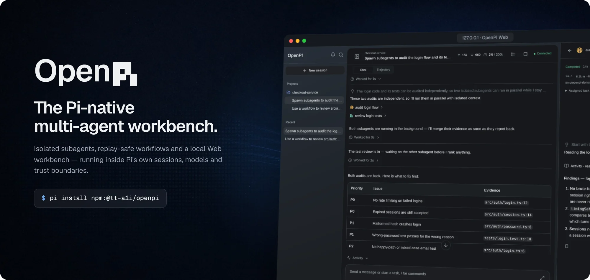
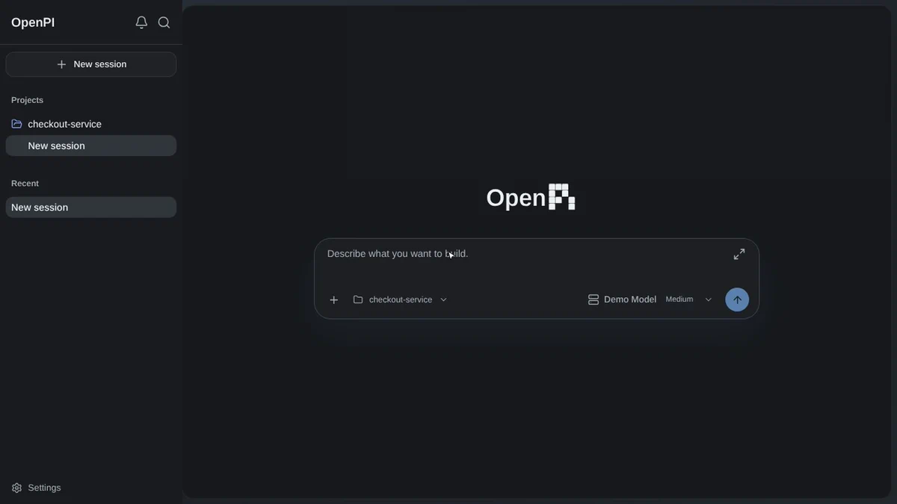
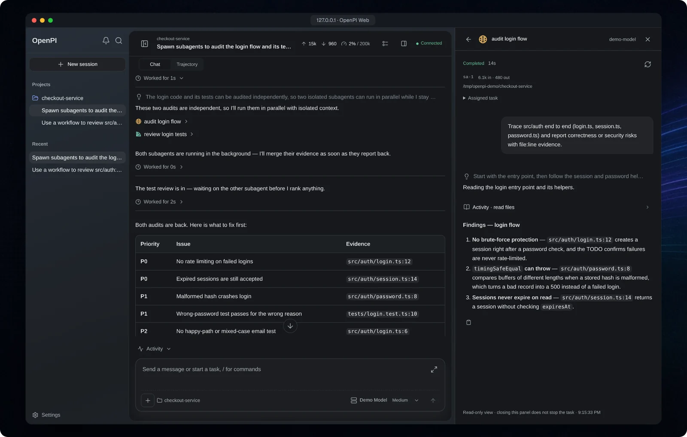
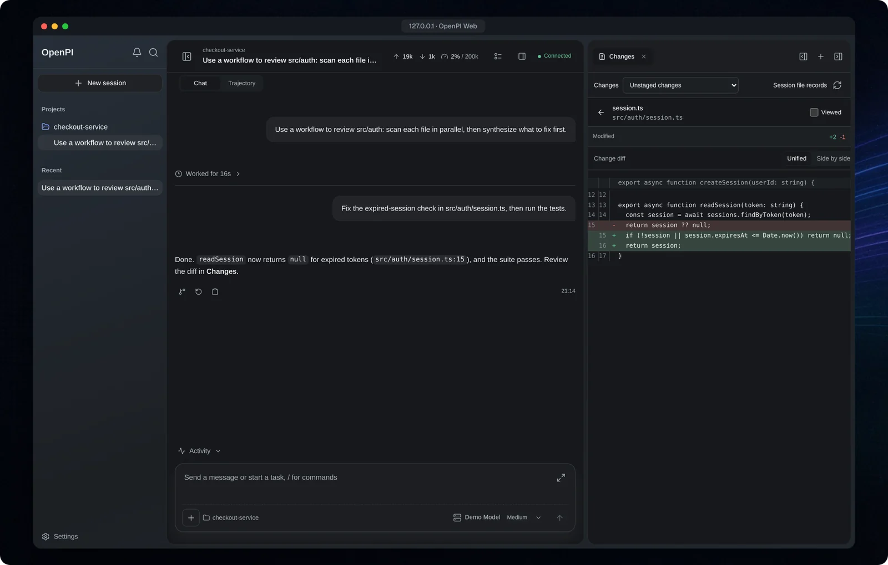
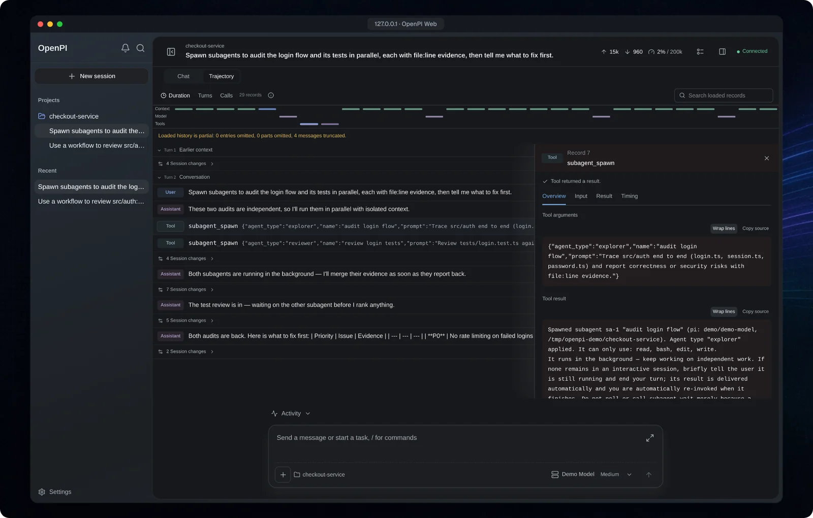
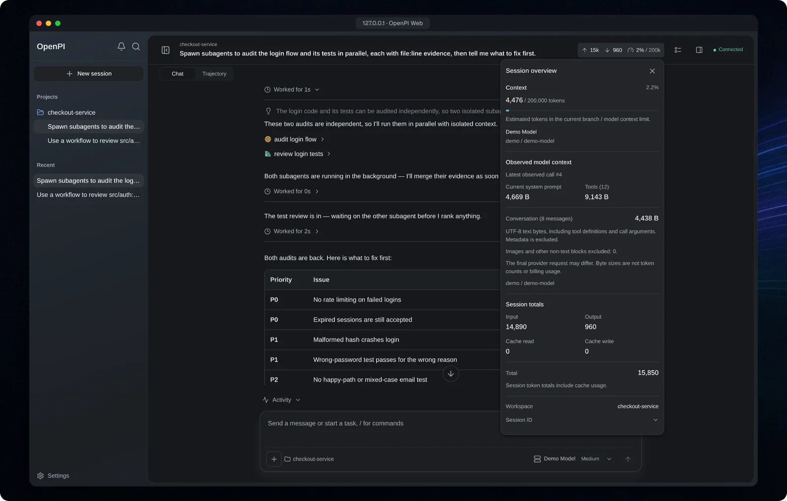
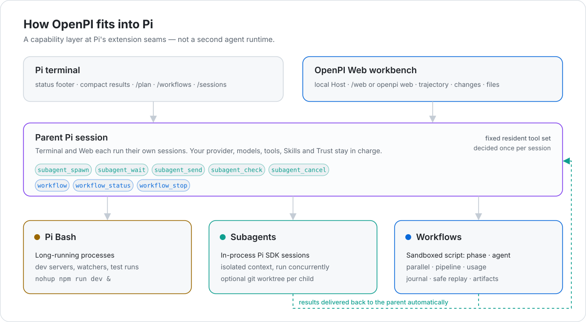

<p align="center">
  <a href="https://github.com/openpi-dev/openpi">
    <picture>
      <source media="(prefers-color-scheme: dark)" srcset="docs/assets/readme/hero-dark.webp">
      <source media="(prefers-color-scheme: light)" srcset="docs/assets/readme/hero-light.webp">
      
    </picture>
  </a>
</p>

<h3 align="center">Stay on your problem. Let independent work run in parallel.</h3>

<p align="center">
  OpenPI adds isolated subagents, replay-safe Workflows and a local Web workbench to <a href="https://pi.dev">Pi</a> —<br />
  inside Pi's own sessions, providers, tools, Skills and Trust. Everyday coding stays light; power unfolds when you ask for it.
</p>

<p align="center">
  <a href="https://www.npmjs.com/package/@tt-a1i/openpi"></a>
  <a href="https://github.com/openpi-dev/openpi/actions/workflows/ci.yml"></a>
  <a href="https://github.com/earendil-works/pi"></a>
  
  <a href="LICENSE"></a>
</p>

<p align="center">
  <a href="#quick-start"><strong>Quick start</strong></a> ·
  <a href="#see-it-work"><strong>Tour</strong></a> ·
  <a href="https://openpi-dev.github.io/openpi/"><strong>Website</strong></a> ·
  <a href="USAGE.md"><strong>Reference</strong></a> ·
  <a href="https://github.com/openpi-dev/openpi/releases"><strong>Releases</strong></a> ·
  <a href="README.zh-CN.md"><strong>中文</strong></a>
</p>

<p align="center">
  <sub>OpenPI is an independent community project, unaffiliated with Physical Intelligence's openpi robotics project and with the Pi team.</sub>
</p>

<br />

<p align="center">
  
  <br />
  <sub>Real OpenPI Web workbench and real tool calls against a small demo repository. Model replies come from a scripted local provider so the recording is reproducible.</sub>
</p>

## Quick start

```bash
pi install npm:@tt-a1i/openpi
```

Restart Pi, or run `/reload` in the current session. Then describe real work — the model decides how to split it:

```text
Spawn subagents to check the login flow and its tests in parallel, each with
file:line evidence, then summarize the findings.
```

```text
Use a workflow to review these modules: collect issues in parallel, verify the
findings, then synthesize what to fix first.
```

```text
Start the dev server in the background with `nohup npm run dev &`, then keep
editing the page; check on it with ordinary process commands when needed.
```

Prefer a browser? Type `/web` in Pi and open the local address printed in the terminal. Web sessions are independent and never take over a terminal conversation. Configure OpenPI itself in plain language with `/openpi-setup`.

OpenPI provides execution, status, results and stop controls. Only genuinely independent tasks benefit from parallelism — the gain depends on the task, model and configuration.

## Why OpenPI

Pi is deliberately small: an agent loop, tools, sessions and an extension API. OpenPI is a capability layer that stays inside Pi's lifecycle, sessions, providers and trust boundaries — not a second agent operating system.

<table>
  <tr>
    <td width="33%" valign="top">
      <h4>Isolated subagents</h4>
      Delegate self-contained work to in-process Pi sessions with their own context. They run concurrently and report back automatically — optionally in their own Git worktree.
    </td>
    <td width="33%" valign="top">
      <h4>Replay-safe workflows</h4>
      Script multi-phase, multi-agent runs with <code>phase</code>, <code>agent</code>, <code>parallel</code> and <code>pipeline</code>. Structured results, a journal, safe replay and auditable artifacts.
    </td>
    <td width="33%" valign="top">
      <h4>Local Web workbench</h4>
      Workspaces, sessions, changes, files and a trajectory inspector for every model and tool call — in a browser, authenticated, on your machine.
    </td>
  </tr>
  <tr>
    <td width="33%" valign="top">
      <h4>Plan mode &amp; human input</h4>
      <code>/plan</code> researches read-only, then turns an explicit Plan Ready into implementation. <code>ask_user</code> and <code>human_handoff</code> collect decisions only you can make.
    </td>
    <td width="33%" valign="top">
      <h4>Semantic navigation</h4>
      A bundled Skill asks an existing local language server for definitions, references and diagnostics — on demand, never started on launch.
    </td>
    <td width="33%" valign="top">
      <h4>Pi-native and quiet</h4>
      Your provider, models, tools, Skills and Trust stay in charge. A fixed resident tool set, no theme or model changes on install, no extra model calls by default.
    </td>
  </tr>
</table>

### New in v1.2.0

- **Semantic navigation Skill** for definitions, references and single-file diagnostics through a local language server. ([#916](https://github.com/openpi-dev/openpi/pull/916))
- **Context composition** in the Web usage popover: system text, tool declarations and conversation of the latest call. ([#914](https://github.com/openpi-dev/openpi/pull/914))
- **Trajectory overview** with context/model/tool tracks, search and a per-call inspector, plus a refreshed workbench, themes and model picker. ([#868](https://github.com/openpi-dev/openpi/pull/868), [#894](https://github.com/openpi-dev/openpi/pull/894), [#904](https://github.com/openpi-dev/openpi/pull/904), [#865](https://github.com/openpi-dev/openpi/pull/865))
- **Quoted review and plan snippets keep their source** (repository, comparison, revision or session). ([#915](https://github.com/openpi-dev/openpi/pull/915))
- **↑/↓ prompt history** in the Web composer, and **custom thinking levels** for custom models. ([#912](https://github.com/openpi-dev/openpi/pull/912), [#864](https://github.com/openpi-dev/openpi/pull/864))
- CI now covers the **minimum and latest supported Pi hosts**. ([#719](https://github.com/openpi-dev/openpi/pull/719)) — [Full release notes](https://github.com/openpi-dev/openpi/releases/tag/v1.2.0)

## See it work

<p align="center">
  <picture>
    <source media="(prefers-color-scheme: dark)" srcset="docs/assets/readme/shot-subagents-dark.webp">
    <source media="(prefers-color-scheme: light)" srcset="docs/assets/readme/shot-subagents-light.webp">
    
  </picture>
  <br />
  <sub><b>Delegate, keep working, inspect.</b> The parent stays free while two isolated subagents audit code; open any child's transcript read-only.</sub>
</p>

<table>
  <tr>
    <td width="33%" valign="top">
      <picture>
        <source media="(prefers-color-scheme: dark)" srcset="docs/assets/readme/shot-changes-dark.webp">
        <source media="(prefers-color-scheme: light)" srcset="docs/assets/readme/shot-changes-light.webp">
        
      </picture>
      <p align="center"><sub><b>Review every change</b><br />Working-tree diffs beside the turn that made them.</sub></p>
    </td>
    <td width="33%" valign="top">
      <picture>
        <source media="(prefers-color-scheme: dark)" srcset="docs/assets/readme/shot-trajectory-dark.webp">
        <source media="(prefers-color-scheme: light)" srcset="docs/assets/readme/shot-trajectory-light.webp">
        
      </picture>
      <p align="center"><sub><b>Trace every call</b><br />Context, model and tool tracks with a per-call inspector.</sub></p>
    </td>
    <td width="33%" valign="top">
      <picture>
        <source media="(prefers-color-scheme: dark)" srcset="docs/assets/readme/shot-context-dark.webp">
        <source media="(prefers-color-scheme: light)" srcset="docs/assets/readme/shot-context-light.webp">
        
      </picture>
      <p align="center"><sub><b>Know your context</b><br />What the latest call actually sent, and session totals.</sub></p>
    </td>
  </tr>
</table>

## How it fits together

<p align="center">
  <picture>
    <source media="(prefers-color-scheme: dark)" srcset="docs/assets/readme/architecture-dark.svg">
    <source media="(prefers-color-scheme: light)" srcset="docs/assets/readme/architecture-light.svg">
    
  </picture>
</p>

## Light by default

Ordinary coding keeps using Pi's native `read`, `bash`, `edit`, `write` — full history, session compaction, tool output bounds, explicit Bash timeouts, and the provider loop. In `pi -p`/`--mode json` runs and in subagent/workflow child sessions — where nobody can interrupt a hung command — a bash call without `timeout` gets a 120-second default; interactive sessions (the terminal and the Web workbench) keep Pi's native behavior with no default. Like Pi, OpenPI adds no deletion guard: `rm` in Bash behaves exactly as Pi does. Long-running processes such as dev servers, watchers, and long test runs go through Pi's Bash directly, e.g. `nohup npm run dev &`.

Every session gets one fixed resident tool set — five subagent tools (`subagent_spawn`, `subagent_wait`, `subagent_cancel`, `subagent_send`, `subagent_check`) and three workflow tools (`workflow`, `workflow_stop`, `workflow_status`) — decided once when the session starts. The list never changes because of prompt keywords or runtime state, so the model-visible surface stays stable and cache-friendly. Only explicit user boundaries add or remove tools: `/plan` adds read-only Git tools, `plan_ready`, and `ask_user`/`human_handoff`; an `/openpi-setup` episode adds `configure_my_pi_setup` and `ask_user`/`human_handoff`; browser control enables `openpi_browser` after authorization.

Installation is quiet: no theme change, no provider or model binding, next-action suggestions off, and no post-edit command. Code Mode (`codemode`) is off by default; opt in via `/openpi-setup`.

| Situation | What the model sees | OpenPI behavior |
| --- | --- | --- |
| Ordinary coding | Pi's native tools plus the fixed resident set | Resident tools are ready from the first turn; never added or removed mid-session |
| Inside `/plan` | Read-only Git, `plan_ready`, `ask_user`/`human_handoff` temporarily added | Original list restored on exit |
| During `/openpi-setup` | `configure_my_pi_setup`, `ask_user`/`human_handoff` temporarily added | Original list restored when the episode ends |
| Subagents or workflows already running | Unchanged — status and management tools always visible | The management surface doesn't follow resource lifecycles |

## Capabilities

### Semantic navigation

The bundled `semantic-navigation` Skill can query an existing local language server for definitions, references and single-file diagnostics through Pi's ordinary Bash tool. Diagnostic comparisons retain ambiguous occurrences instead of treating matching messages as proof that nothing changed. No server is installed or started on launch; use requires an explicit server command and Bash permission. See [usage and limits](USAGE.md#semantic-navigation).

### Subagents

```text
subagent_spawn({
  agent_type: "explorer",
  name: "audit auth flow",
  prompt: "Trace src/auth end to end and report file:line evidence."
})
```

Each subagent is a new in-process Pi SDK session: it inherits the parent's provider, model, tools, and Skills; runs concurrently with isolated context; and reports back automatically when done. You can `check`, `wait`, `cancel`, or keep talking to it with `subagent_send`.

| `agent_type` | Best for | Relative effort hint |
| --- | --- | --- |
| `explorer` | Code tracing and exploration | Medium; raise for hard problems |
| `implementer` | Focused implementation | Medium-high, scaled to scope and risk |
| `reviewer` | Correctness and regression review | Higher |
| `advisor` | Deep technical advice | Higher |

For parallel work that writes files, `isolation: "worktree"` gives the child its own checkout and branch under `.git/pi-worktrees/`.

Details — role files, model precedence, worktree lifecycle, structured output: [USAGE.md](USAGE.md#subagent-细节)

### Workflows

A subagent handles one delegation. A workflow handles phase dependencies, dynamic fan-out, structured results, and synthesis:

```js
const scans = await parallel(
  files.map((file) => () =>
    agent(`Trace ${file} for reliability risks`, {
      agent_type: "explorer",
      label: `scan:${file}`,
      schema: FINDING_SCHEMA,
    }),
  ),
);
return agent("Synthesize the findings", {
  agent_type: "advisor",
  inputs: scans.filter((r) => r?.ok).map((r) => r.ref),
});
```

| Primitive | Purpose |
| --- | --- |
| `phase()` | Mark the current phase |
| `log()` | Append a progress line to the live view and final report |
| `usage()` | Read cumulative tokens, cache, cost, and remaining call/concurrency budget |
| `agent()` | Start a Pi agent; supports role, schema, inputs, operator, and worktree |
| `pipeline()` | Each item enters the next stage as soon as it finishes — the default for multi-stage fan-out |
| `parallel()` | Concurrency barrier over zero-argument thunks; use only when the next stage needs every result |

Details — limits, Result Handoff, Invocation Ledger, Safe Replay, Operator, Worktree Handoff, timing: [USAGE.md](USAGE.md#workflow-细节)

### Web workbench

- Workspace and session management in the browser, with saved prompts, tool evidence, and persistent trajectory inspection.
- Runs as a separate process with its own sessions — it never takes over a terminal conversation.
- Run `/web` inside Pi, or install the matching CLI:

```bash
pi install npm:@tt-a1i/openpi
npm install --global @tt-a1i/openpi
openpi web                    # start in the current directory
openpi web /path/to/repo      # start with a specific workspace
```

Keep the Pi package and the global CLI on the same OpenPI version.

Closing a tab leaves accepted work running in the local Host. Use **Quit OpenPI** in the sidebar and confirm to stop the application and its tasks; the terminal confirms when cleanup finishes. Restart with `openpi web` or `/web`. Saved parent conversations retain read-only child history across Host restarts, including Direct, BTW and Workflow children; inspecting history does not restart execution. Empty conversations keep Pi’s lazy-save behavior.

Details — sessions, host and forks, credentials, models, files, preview, changes, attachments, embedded browser, cards, commands: [USAGE.md](USAGE.md#web-工作台细节)

### Plan mode & human input

`/plan [goal]` runs read-only research with read-only Git tools and `ask_user`; only an explicit Plan Ready turns into an implementation prompt. `ask_user` collects reviewed decisions, and the parent-only `human_handoff` waits for operations only the user can perform. Details: [USAGE.md](USAGE.md#plan-mode-与人工输入)

### Terminal experience

A one-line footer compresses real model/context/git state with small icons; Bash, Write/Edit, and subagent results render compact by default (`Ctrl+O` expands to full output); Plan-mode Git inspection, session-scoped cron, and helpers like `/lg`, `/pr`, `/copy-all` round out daily work. The package also registers the `github-dark-default` theme without switching to it — pick it in Pi `/settings`. Details: [USAGE.md](USAGE.md#终端体验细节)

## Where should a task go?

```text
Long-running process                    → Pi Bash (e.g. `nohup … &`)
A self-contained, resumable delegation  → Subagent
Multi-phase, dependencies, fan-out      → Workflow
Truly cross top-level sessions          → pi-intercom, installed separately
```

[pi-intercom](https://github.com/nicobailon/pi-intercom) is an independently maintained Pi package. OpenPI does not detect, recommend, install, or configure it; review its own repository and install it through Pi's native package commands if you need top-level session messaging.

## Safety boundaries

Safety here is a runtime constraint, not a prompt.

| Boundary | Behavior |
| --- | --- |
| Child orchestration | Forbidden — subagent/workflow children get no parent orchestration, interaction, or state tools |
| Agent-type tools | Harness-enforced allowlist; declarations cannot break the parent denylist |
| Type/tool preflight | Unknown, broken, misnamed, or unregistered tools fail before the first token |
| Workflow sandbox | No file, network, process, import, eval, or timer APIs; the process can only read the startup package directory |
| Replay | Only provably read-only calls with intact fingerprints and no unsafe overlap are cached |
| Worktree cleanup | Unknown means keep — never delete when Git, handoff, or timeout state is uncertain |
| Terminal output | Control characters, direction marks, and oversized content sanitized at ingress/render boundaries |
| Shutdown | Subagents and workflows get bounded cancel, cleanup, and a single terminal state |
| User configuration | Shared validation and storage; natural language uses a restricted writer tool, Web display controls save directly |
| Model consumption | Suggestions off by default; extra model calls happen only when the parent model invokes tools inside a user-started turn |

## Configuration

`/openpi-setup` is the natural-language configuration entry point; Web display preferences (theme, palette, font, chat width, font size, sidebar grouping and order, pinned order, thinking display) save directly without a model turn. Configuration lives in `~/.pi/agent/my-pi-setup.json`, separate from the package — upgrades never overwrite it, and staying at defaults creates no file.

```text
/openpi-setup enable next-action suggestions with a lightweight Registry model, minimal reasoning
/openpi-setup run 16 workflow agents concurrently, at most 256 total agent calls
/openpi-setup allow at most 6 concurrent Workflow, Direct and BTW children in this Pi session
/openpi-setup make the Web theme follow the system
/openpi-setup use a dark Web theme
/openpi-setup use the mist palette, set chat width to 960px
/openpi-setup set chat font size to 16px, expand thinking blocks by default
/openpi-setup set response verbosity to high, reasoning summary to none
/openpi-setup two-line footer: cwd flex model / context cost flex git
/openpi-setup expand Bash results, keep Write/Edit compact
/openpi-setup run npm run format after edits
/openpi-setup assign a model to explorer, let reviewer inherit the parent model
```

### Defaults

<details>
<summary><strong>All defaults</strong> — every setting starts here; staying at defaults creates no file.</summary>

| Setting | Default |
| --- | --- |
| Code Mode (`code_mode_enabled`) | Off; opt in via `/openpi-setup` |
| Web search (`web_search_enabled`) | Off; provider-native search only |
| Web search model support (`web_search_model_support`) | Auto-detected per provider/model/API/base URL |
| Response verbosity / reasoning summary (`response_verbosity` / `response_reasoning_summary`) | `default` / `default` — preserves Pi's native request |
| Next-action Suggestion | Off; when enabled, an explicit Registry model and reasoning level |
| Workflow concurrency / max agent calls | 8 / 128; hard caps 64 / 1024 |
| Session child execution slots | Off; when set to 1–64, shared by Workflow / Direct / BTW |
| Browser control (`browser_control` / `browser_embedded` / `browser_default` / `browser_external`) | `false` / `true` / `embedded` / `[]` |
| Web theme | `system`; also `light` / `dark`; legacy `mist` / `rose` / `pine` palettes still honored |
| Web appearance (`ui.webAppearance`) | palette `default`; accent/background/foreground `""` (theme colors); font `codex` |
| Web chat width / chat font size | 820px / 14px; ranges 820–2000px / 12–24px |
| Web sidebar width / auxiliary pane width | 260px (range 220–520px) / 520px (range 360–720px) |
| Web thinking blocks | Collapsed by default |
| Web follow-up behavior (`ui_web_follow_up_behavior`) | `followUp` (queue); `steer` (guide the active turn) also available |
| Hidden thinking levels (`web_hidden_thinking_levels`) | `[]` — every natively supported level shown, current selection unchanged |
| Web pinned sort | `manual`; `updated` (recently updated) also available |
| Web sidebar grouping | `project`; `list` (single recent list) also available |
| Web conversation order | `updated`; `manual` also available |
| Recent list shows project sessions | On; off shows ungrouped sessions only |
| Large header | Off |
| Custom dashboard footer | On; single line, `plain` style — `footerLines` is the persisted format; `powerline`, `powerline-mono`, `compact` presets available |
| Subagent / Bash / Write/Edit result display | `compact` / `compact` / `compact` |
| Post-edit command | Off; a single command of at most 500 characters |
| Built-in role models | All inherit the parent model |

</details>

<!-- config-contract: codeMode.enabled webSearch.enabled webSearch.modelSupport response.verbosity response.reasoningSummary suggestions.enabled suggestions.model workflows.concurrency workflows.maxAgentCalls childExecutions childExecutions.maxActive browser.control browser.embedded browser.defaultBrowser browser.externalBrowsers ui.webTheme ui.webAppearance ui.webChatWidth ui.webSidebarWidth ui.webAuxiliaryWidth ui.webChatFontSize ui.webExpandThinking ui.webFollowUpBehavior ui.webHiddenThinkingLevels ui.webPinnedSort ui.webSidebarGrouping ui.webChatsSort ui.webProjectsInRecents ui.showHeader ui.customFooter ui.footerStyle ui.footerLines ui.subagentResultDisplay ui.bashToolDisplay ui.fileMutationDisplay postEdit.command subagents.roleModels -->

Settings → General saves the follow-up default in `ui.webFollowUpBehavior`. The composer override and Command/Ctrl+Enter change only one message. After the active turn ends, the next explicit submit starts a normal turn; the draft is never sent automatically. `/openpi-setup` edits the same preference.

See [SETUP.md](SETUP.md) for the full field reference and lifecycle details.

## Commands

| Command | What it does |
| --- | --- |
| `/openpi-setup [request]` | View or change OpenPI's own configuration |
| `/web` | Run the standalone Web workbench in the foreground; `Ctrl+C` returns to Pi |
| `/subagents` / `/btw` | Manage subagents / ask a side-channel question; TUI only |
| `/workflows` | Inspect phases, agents, graph, and artifacts; stop runs |
| `/sessions` | Search, preview, and switch sessions |
| `/plan [goal]` | Read-only research; choose implementation explicitly after Plan Ready |
| `/cron ...` | Schedule a one-off or recurring prompt for the current session |
| `/usage [options]` | Show subscription quota snapshots (Cursor / Codex / Antigravity) |
| `/lg` / `/pr` | Browse diffs (`/lg` TUI only) / explicitly refresh the current branch's PR |
| `/copy-all` | Copy the visible conversation of the current branch |

## Requirements and install sources

- Pi `0.99.1` or newer; the dev dependency and CI baseline is `1.2.0`.
- Node.js `22.19.0` or newer.
- npm: `pi install npm:@tt-a1i/openpi`
- GitHub: `pi install git:github.com/openpi-dev/openpi`

Browser control uses the optional [OpenPI Browser Bridge](web/browser-extension/README.md) 0.4.0 with native browser installation and permission confirmation.

## FAQ

<details>
<summary><strong>Does installing OpenPI call extra models automatically?</strong></summary>

No. Suggestions are off by default. The resident tool set is only an interface the model may call — extra model calls for a subagent or workflow happen only when the parent model invokes the tool inside a user-started turn, and the concurrency and workflow call caps still apply.

</details>

<details>
<summary><strong>Does a subagent block the parent agent?</strong></summary>

No. `subagent_spawn` returns immediately, and the result is delivered back to the parent automatically when the subagent finishes, so you can keep working in the meantime. In a non-interactive run (`pi -p`, `--mode json`) the process exits when the turn ends, so the model is told to `subagent_wait` for every result it needs before the final answer. For machine-verifiable output, pass `output_schema` to get a validated JSON result back.

</details>

<details>
<summary><strong>Why both subagents and workflows?</strong></summary>

A subagent is one self-contained delegation you can keep talking to; a workflow is multi-phase orchestration for fan-out, structured results, recovery, and durable artifacts.

</details>

<details>
<summary><strong>Why does Plan mode allow `git log` but refuse `npm install`?</strong></summary>

Plan mode only admits commands built from known read-only parts instead of guessing whether arbitrary shell is safe. Narrow Git queries that cannot generate diffs pass; shell metacharacters, unknown flags, installs, writes, and unprovable forms are refused. Details: [USAGE.md](USAGE.md#plan-mode-与人工输入).

</details>

<details>
<summary><strong>Do background services become orphans?</strong></summary>

OpenPI doesn't manage background processes. Start long-running services through Pi's Bash (`nohup npm run dev &`); their lifecycle belongs to the local environment and is managed with ordinary process tools.

</details>

<details>
<summary><strong>Is this a stable API?</strong></summary>

OpenPI is an actively used independent distribution without a forever-frozen extension API. Changes go through TypeScript, format checks, and focused tests; when Pi changes upstream, the priority is preserving session lifecycle, tool boundaries, result deduplication, and resource cleanup.

</details>

## Development

See [CONTRIBUTING.md](CONTRIBUTING.md) for the repository layout, toolchain, and the npm-vs-source development runtime procedure.

## License and acknowledgements

[MIT License](LICENSE) · [Third-party sources and notices](THIRD_PARTY_NOTICES.md) · [All contributors](https://github.com/openpi-dev/openpi/graphs/contributors)
