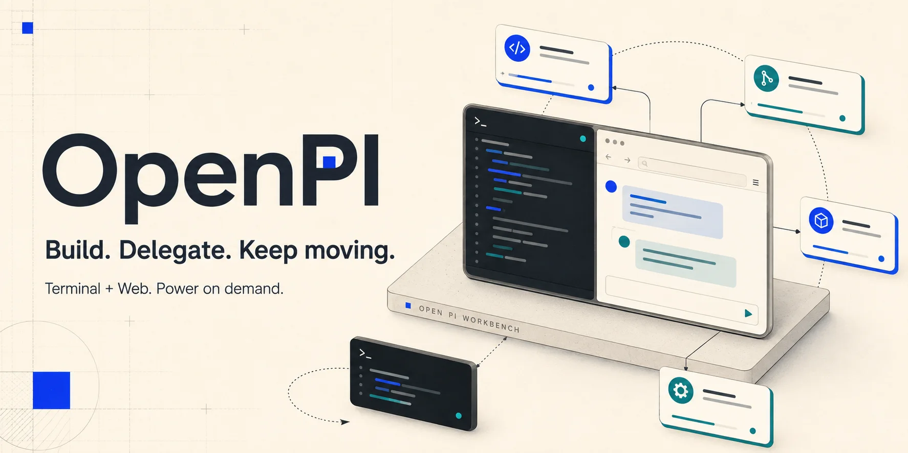

<p align="center">
  
</p>

<p align="center">
  <strong>专注手上的问题，让独立任务并行。</strong><br />
  OpenPI 为 <a href="https://pi.dev">Pi</a> 增加终端与本地 Web 工作台、独立上下文的子代理和 Workflow。<br />
  沿用你的模型、工具与 Skills；普通编码保持轻量，需要时再展开高级能力。
</p>

<p align="center">
  <a href="https://www.npmjs.com/package/@tt-a1i/openpi"></a>
  <a href="https://github.com/openpi-dev/openpi/actions/workflows/ci.yml"></a>
  <a href="https://github.com/earendil-works/pi"></a>
  
  <a href="LICENSE"></a>
</p>

```bash
pi install npm:@tt-a1i/openpi
```

<p align="center">
  <a href="https://openpi-dev.github.io/openpi/"><strong>项目网站</strong></a> ·
  <a href="#快速开始"><strong>立即开始</strong></a> ·
  <a href="USAGE.md"><strong>详细参考</strong></a> ·
  <a href="README.md"><strong>English</strong></a>
</p>

<p align="center">
  <sub>OpenPI 是独立社区项目，与 Physical Intelligence 的 openpi 机器人项目及 Pi 官方均无关联。</sub>
</p>

---

## OpenPI 是什么

Pi 的价值在于小：Agent loop、工具、Session 与扩展 API 已经足够。OpenPI 是围绕这些原语的能力层，始终留在 Pi 的生命周期、Session、Provider 与 Trust 边界内——不是另一套 Agent 操作系统。

- **本地 Web 工作台**：在浏览器中管理工作区与会话，检查已保存的 Prompt、工具参数与结果；与终端会话相互独立。
- **Subagent**：把自包含的任务委派给独立上下文的进程内 Pi Session，结果自动回传。
- **Workflow**：多阶段、多 Agent 编排，提供结构化结果、Safe Replay 与可审计产物。
- **终端体验**：状态 Footer、紧凑工具结果、Plan Mode 与 Session 级辅助能力。
- **Pi-native**：Provider、模型、工具、Skills、Session 与 Trust 仍由你掌控；OpenPI 只在 Pi 的扩展缝上增加能力。

## 快速开始

```bash
pi install npm:@tt-a1i/openpi
```

重启 Pi，或在当前 Session 运行 `/reload`。然后直接描述真实任务：

```text
用 `nohup npm run dev &` 在后台启动开发服务器，我继续修改页面；
需要时用普通进程命令查看它的状态。
```

```text
用子代理分别检查登录流程和相关测试，各自给出问题与证据，最后汇总。
```

```text
用 Workflow 分批审查这些模块，先并行收集问题，再汇总需要优先处理的项。
```

模型负责判断怎么分工；OpenPI 提供执行、状态、结果和停止入口。独立任务才值得并行，具体收益取决于任务、模型和配置。

更喜欢浏览器？在 Pi 中输入 `/web`，打开终端显示的本机地址，选择模型和工作区后开始对话。Web 使用独立会话，不会接管终端里正在进行的对话。详见 [Web 工作台](#web-工作台)。

OpenPI 自有偏好通过自然语言配置：

```text
/openpi-setup
```

## 默认轻，按需强

普通编码任务继续走 Pi 原生路径：`read`、`bash`、`edit`、`write`，完整历史、Session compaction、工具输出边界、显式 Bash timeout 与 Provider loop。在 `pi -p`/`--mode json` 运行和 Subagent/Workflow 子会话中——没有人可以中断挂起的命令——未带 `timeout` 的 Bash 调用使用 120 秒默认上限；交互会话（终端与 Web 工作台）沿用 Pi 行为，无默认超时。与 Pi 一样，OpenPI 不添加删除保护：Bash 中的 `rm` 完全沿用 Pi 自身行为。长期进程（dev server、watcher、长测试）直接使用 Pi 的 Bash 后台运行，例如 `nohup npm run dev &`。

每个 Session 获得一套固定的常驻工具集——Subagent 5 个（`subagent_spawn`、`subagent_wait`、`subagent_cancel`、`subagent_send`、`subagent_check`）与 Workflow 3 个（`workflow`、`workflow_stop`、`workflow_status`）——在 Session 开始时确定一次，之后不因 Prompt 关键词或运行时状态变化而改变，模型可见的工具面因此稳定且对缓存友好。只有明确的用户边界会临时增减工具：进入 `/plan` 加入只读 Git、`plan_ready` 与 `ask_user`/`human_handoff`；`/openpi-setup` 进行期间加入 `configure_my_pi_setup` 与 `ask_user`/`human_handoff`；浏览器控制经授权后启用 `openpi_browser`。

默认安装是安静的：不改主题、不绑定 Provider 或模型、不开启下一步预测，也不执行 post-edit 命令。Code Mode（`codemode`）默认关闭，可通过 `/openpi-setup` 开启。

| 使用场景 | 模型看到什么 | OpenPI 的行为 |
| --- | --- | --- |
| 普通编码任务 | Pi 原生 `read` / `bash` / `edit` / `write`，外加固定的常驻工具集 | 常驻工具在 Session 开始时就绪，会话内不增删 |
| 进入 `/plan` | 只读 Git、`plan_ready` 与 `ask_user`/`human_handoff` 临时加入 | 退出 Plan Mode 时恢复原始列表 |
| `/openpi-setup` 进行中 | `configure_my_pi_setup` 与 `ask_user`/`human_handoff` 临时加入 | Episode 结束后恢复原始列表 |
| Subagent 或 Workflow 已在运行 | 不变——状态与管理工具始终可见 | 管理面不随资源生命周期增删 |

## 能力

### Subagent

```text
subagent_spawn({
  agent_type: "explorer",
  name: "audit auth flow",
  prompt: "Trace src/auth end to end and report file:line evidence."
})
```

每个 Subagent 都是新的进程内 Pi SDK Session：继承父会话的 Provider、模型、工具与 Skills；使用独立 Context 并行运行；结束后自动回传。可以 `check`、`wait`、`cancel`，也可以用 `subagent_send` 继续同一子会话。

| `agent_type`  | 适合             | 相对 effort 建议 |
| ------------- | ---------------- | ---------------- |
| `explorer`    | 代码追踪与探索   | 中等，难题可提高 |
| `implementer` | 聚焦实现         | 中高，按范围与风险调整 |
| `reviewer`    | 正确性与回归审查 | 较高 |
| `advisor`     | 深度技术建议     | 较高 |

并行写文件时使用 `isolation: "worktree"`，子代理会在 `.git/pi-worktrees/` 获得独立 checkout 与分支。

细节——角色文件、模型优先级、Worktree 生命周期、结构化输出：[USAGE.md](USAGE.md#subagent-细节)

### Workflow

单个 Subagent 负责一项委派。Workflow 处理阶段依赖、动态 fan-out、结构化结果与综合：

```js
const scans = await parallel(
  files.map((file) => () =>
    agent(`Trace ${file} for reliability risks`, {
      agent_type: "explorer",
      label: `scan:${file}`,
      schema: FINDING_SCHEMA,
    }),
  ),
);
return agent("Synthesize the findings", {
  agent_type: "advisor",
  inputs: scans.filter((r) => r?.ok).map((r) => r.ref),
});
```

| 原语         | 作用                                                                       |
| ------------ | -------------------------------------------------------------------------- |
| `phase()`    | 标记当前阶段                                                               |
| `log()`      | 向实时界面与最终报告追加一行进度                                           |
| `usage()`    | 读取累计 Token、缓存、成本及本轮并发/调用余量；Token 是 lower bound，不是预算器 |
| `agent()`    | 启动 Pi Agent；支持 role、schema、inputs、operator 与 worktree |
| `pipeline()` | 每个 item 完成上阶段后立即进入下一阶段；多阶段 fan-out 的默认选择          |
| `parallel()` | 针对零参数 thunk 的并发 barrier；只在下一阶段确实需要全部结果时使用        |

细节——并发与上限、Result Handoff、Invocation Ledger、Safe Replay、Operator、Worktree Handoff、计时边界：[USAGE.md](USAGE.md#workflow-细节)

### Web 工作台

- 在浏览器中管理工作区与会话，检查已保存的 Prompt、工具证据与持久化轨迹；
- 独立进程、独立会话，不接管终端里正在进行的对话；
- 在 Pi 中输入 `/web`，或安装同版本 CLI 后运行：

```bash
pi install npm:@tt-a1i/openpi
npm install --global @tt-a1i/openpi
openpi web                    # 使用当前目录启动 Web
openpi web /path/to/repo      # 指定初始工作区
```

两处应保持同一 OpenPI 版本。

细节——会话、Host 与分叉、凭据、模型、文件、预览、变更、附件、内嵌浏览器、卡片与命令：[USAGE.md](USAGE.md#web-工作台细节)

### Plan Mode 与人工输入

`/plan [目标]` 以只读方式调研，加入只读 Git 与 `ask_user`；只有显式 Plan Ready 后才准备实施 Prompt。`ask_user` 收集经复核的决策；parent-only 的 `human_handoff` 等待只有用户能完成的外部操作。细节：[USAGE.md](USAGE.md#plan-mode-与人工输入)

### 终端体验

一行 Footer 用小图标压缩真实的模型、context 与 Git 状态；Bash、Write/Edit 与 Subagent 结果默认紧凑显示（`Ctrl+O` 展开完整输出）；Plan 内只读 Git、Session 级定时任务和 `/lg`、`/pr`、`/copy-all` 覆盖日常工作。包内还注册了 `github-dark-default` 主题，不自动切换，可在 Pi `/settings` 中选择。细节：[USAGE.md](USAGE.md#终端体验细节)

## 一项任务应该去哪里？

```text
长期进程                         → Pi 的 Bash（如 `nohup … &`）
一项自包含、可继续对话的委派     → Subagent
多阶段、依赖、fan-out 与综合      → Workflow
真正跨顶层 Session               → pi-intercom，按需独立安装
```

[pi-intercom](https://github.com/nicobailon/pi-intercom) 是独立维护的 Pi package。OpenPI 不探测、推荐、安装或配置它；需要跨顶层 Session 通信时，请先审查其独立仓库，再通过 Pi 原生 package 命令按需安装。

## 安全边界

这里的安全不是一段 Prompt，而是运行时约束。

| 边界             | 行为                                                                      |
| ---------------- | ------------------------------------------------------------------------- |
| Child 递归编排   | 禁止；Subagent / Workflow child 不获得父级编排、交互与状态工具            |
| Agent Type 工具  | Harness 强制白名单；声明不能突破父级 denylist                             |
| 类型与工具预检   | 未知、损坏、错名或最终未注册的工具在首个 Token 前失败                     |
| Workflow Sandbox | 无文件、网络、进程、import、eval 或 timer API；进程仅可读启动包目录       |
| Replay           | 只有可证明只读、指纹完整且无不安全重叠的调用才缓存                        |
| Worktree 清理    | 未知即保留；Git、Handoff 或超时状态不确定时绝不删除                       |
| 终端输出         | 控制字符、方向格式符与超长内容在 ingress / render 边界清洗、限长          |
| Shutdown         | Subagent、Workflow 都有有界取消、清理与唯一终态                           |
| 用户配置         | 共享校验与存储；自然语言使用受限工具，Web 显示控件直接保存                 |
| 模型消费         | Suggestion 默认关闭；Subagent / Workflow 的额外模型调用只在主模型于用户发起的轮次中调用工具时发生 |

## 配置

`/openpi-setup` 是自然语言配置入口；Web 的主题、配色、字体、聊天宽度、字号、侧栏分组、排序、置顶顺序和思考块显示控件直接保存，不调用模型。配置保存在 `~/.pi/agent/my-pi-setup.json`，与包代码分离，升级不会覆盖；保持默认值不会创建文件。

```text
/openpi-setup 开启下一步预测，选择 Registry 里的轻量模型，minimal 推理
/openpi-setup workflow 同时跑 16 个 agent，总调用最多 256
/openpi-setup 当前 Pi Session 的 Workflow、Direct 和 BTW 最多同时运行 6 个 child
/openpi-setup Web 主题跟随系统
/openpi-setup Web 使用深色主题
/openpi-setup Web 使用雾青主题，聊天宽度设为 960px
/openpi-setup 聊天字号设为 16px，默认展开思考块
/openpi-setup 响应详细程度设为 high，推理摘要设为 none
/openpi-setup Footer 两行：cwd flex model / context cost flex git
/openpi-setup Bash 展开，Write/Edit 保持紧凑
/openpi-setup 编辑后自动跑 npm run format
/openpi-setup 给 explorer 指定模型，让 reviewer 继承父模型
```

### 默认值

| 配置 | 默认值 |
| --- | --- |
| Code Mode（`code_mode_enabled`） | 关闭；通过 `/openpi-setup` 开启 |
| 联网搜索（`web_search_enabled`） | 关闭；只使用供应商原生搜索 |
| 搜索模型支持（`web_search_model_support`） | 按 provider/model/API/base URL 自动判断 |
| 响应详细程度 / 推理摘要（`response_verbosity` / `response_reasoning_summary`） | `default` / `default`，保留 Pi 原生请求 |
| Next-action Suggestion | 关闭；启用时显式选择 Registry 模型与 reasoning |
| Workflow 并发 / 总调用 | 8 / 128；硬上限 64 / 1024 |
| Session child execution slots | 关闭；显式设为 1-64 后由 Workflow / Direct / BTW 共享 |
| 浏览器控制（`browser_control` / `browser_embedded` / `browser_default` / `browser_external`） | `false` / `true` / `embedded` / `[]` |
| Web 主题 | `system`；另有 `light` / `dark`，兼容旧 `mist` / `rose` / `pine` 预设 |
| Web 外观（`ui.webAppearance`） | 配色 `default`，强调色/背景/前景 `""`（主题默认色），字体 `codex` |
| Web 聊天宽度 / 聊天字号 | 820px / 14px；范围 820-2000px / 12-24px |
| Web 侧栏宽度 / 工具面板宽度 | 340px（范围 220–520px）/ 520px（范围 360–720px） |
| Web 思考块 | 默认折叠 |
| 隐藏推理强度（`web_hidden_thinking_levels`） | `[]`；显示全部原生支持的级别，不改当前选择 |
| Web 置顶排序 | `manual` 手动排序；可选 `updated` 最近更新 |
| Web 侧栏分组 | `project` 按项目；可选 `list` 统一最近列表 |
| Web 会话排序 | `updated` 最近更新；可选 `manual` 手动排序 |
| 最近列表显示项目会话 | 默认开启；关闭时最近列表仅显示未分组会话 |
| 大型 Header | 关闭 |
| Dashboard Footer | 开启；单行 `plain`——`footerLines` 为持久化格式；另有 `powerline`、`powerline-mono`、`compact` 预设 |
| Subagent / Bash / Write/Edit | `compact` / `compact` / `compact` |
| Post-edit 命令 | 关闭；单条命令最多 500 字符 |
| 内置角色模型 | 全部继承父模型 |

完整字段说明与生命周期见 [SETUP.md](SETUP.md)。

## 命令速查

| 命令                       | 作用                                           |
| -------------------------- | ---------------------------------------------- |
| `/openpi-setup [自然语言]` | 查看或修改 OpenPI 自有配置                     |
| `/web`                     | 前台运行独立 Web 工作台；`Ctrl+C` 后返回 Pi    |
| `/subagents` / `/btw`      | 管理 Subagent / 在旁路 Context 中提问；仅 TUI  |
| `/workflows`               | 查看阶段、Agent、Graph 与产物；可停止运行      |
| `/sessions`                | 搜索、预览与切换 Session                       |
| `/plan [目标]`             | 只读调研；Plan Ready 后显式选择实施方式        |
| `/cron ...`                | 为当前 Session 安排一次或周期性 Prompt         |
| `/usage [选项]`            | 查看订阅额度快照（Cursor / Codex / Antigravity） |
| `/lg` / `/pr`              | 浏览 Diff（`/lg` 仅 TUI）/ 显式刷新当前分支 PR |
| `/copy-all`                | 复制当前分支可见对话                           |

## 安装要求与来源

- Pi `0.99.1` 或更新版本；开发依赖与 CI 验证基线为 `1.2.0`；
- Node.js `22.19.0` 或更新版本；
- npm 安装：`pi install npm:@tt-a1i/openpi`；
- GitHub 安装：`pi install git:github.com/openpi-dev/openpi`。

浏览器控制使用可选的 [OpenPI Browser Bridge](web/browser-extension/README.md) 0.4.0，需浏览器原生安装及权限确认。

## FAQ

<details>
<summary><strong>安装后会自动调用额外模型吗？</strong></summary>

默认不会。Suggestion 默认关闭。常驻工具集只是模型可调用的接口；Subagent 或 Workflow 的额外模型调用只在主模型于用户发起的轮次中主动调用工具时发生，并发和 Workflow 总调用上限仍然生效。

</details>

<details>
<summary><strong>Subagent 会阻塞主 Agent 吗？</strong></summary>

不会。`subagent_spawn` 立即返回，子代理结束后结果自动回传给主 Agent，期间可以继续做别的事。非交互运行（`pi -p`、`--mode json`）在轮次结束时退出进程，因此模型会被要求在最终回答前对每个需要的结果调用 `subagent_wait`。需要机器可验证的输出时，可提供 `output_schema` 获得校验后的 JSON 结果。

</details>

<details>
<summary><strong>为什么同时提供 Subagent 和 Workflow？</strong></summary>

Subagent 是一项可继续对话的自包含委派；Workflow 是多阶段编排，强调 fan-out、结构化结果、恢复、验收与持久产物。

</details>

<details>
<summary><strong>Plan Mode 为什么允许 git log，却拒绝 npm install？</strong></summary>

Plan Mode 不猜“任意 Shell 是否只读”，只放行由已知安全零件组成的命令。不会生成 diff 的窄白名单 Git 查询可以通过；Shell 元字符、未知 flag、安装、写入和无法证明的形式全部拒绝。细节：[USAGE.md](USAGE.md#plan-mode-与人工输入)。

</details>

<details>
<summary><strong>后台服务会不会变成孤儿进程？</strong></summary>

OpenPI 不托管后台进程。需要长期运行的服务由 Pi 的 Bash 直接启动（例如 `nohup npm run dev &`），其生命周期归属本机环境，用普通进程命令管理。

</details>

<details>
<summary><strong>这是稳定 API 吗？</strong></summary>

这是持续实际使用的独立发行版，不承诺扩展 API 永远不变。改动会经过 TypeScript、格式检查与专项测试；Pi 上游变化时，优先保持 Session 生命周期、工具边界、结果去重与资源清理这些行为不变量。

</details>

## 开发

仓库结构、工具链与“npm 与当前源码”的运行时区分见 [CONTRIBUTING.md](CONTRIBUTING.md)。

## 许可与致谢

[MIT License](LICENSE) · [第三方来源与致谢](THIRD_PARTY_NOTICES.md) · [所有贡献者](https://github.com/openpi-dev/openpi/graphs/contributors)
