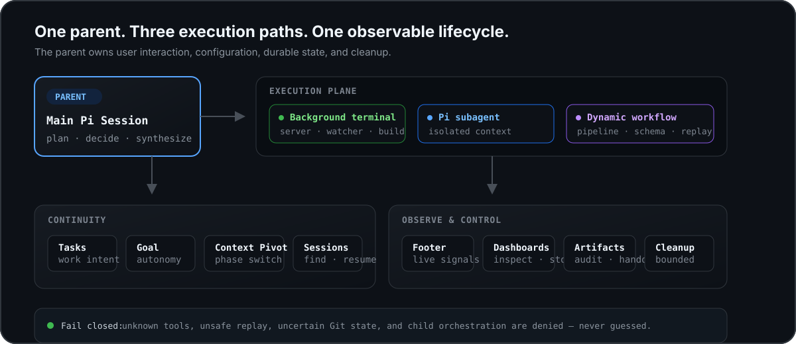

# OpenPI 使用细节参考

本文是 [README.md](README.md)（[中文](README.zh-CN.md)）的详细参考，集中保留各能力的行为细节与边界说明。入门介绍与快速开始见 README。

## OpenPI 解决什么

Pi 的价值在于小：Agent loop、工具、Session 与扩展 API 已经足够。真实项目缺的不是另一套平台，而是围绕这些原语的一层可靠运行时。

| 开发现场                                | OpenPI 的处理方式                                                            | 保留的边界                         |
| --------------------------------------- | ---------------------------------------------------------------------------- | ---------------------------------- |
| Dev server、watcher、长测试占住主 Agent | Pi 的 Bash 直接后台运行长期进程（如 `nohup … &`）                          | 进程属于本机环境，Session 不托管   |
| 调研、实现、审查互相污染 Context        | 每个 Subagent 使用独立的进程内 Pi SDK Session                                | Child 不能递归编排或拿回父级工具   |
| 多阶段 fan-out 靠 Prompt 约定           | Workflow 提供 pipeline、schema、handoff、验收与持久产物                      | Sandbox 不暴露文件、网络或进程 API |
| 重跑昂贵，却不能信任旧结果              | 只 Replay 在可观测边界内证明为只读且指纹未变的调用                           | 不确定就真实执行，不猜             |
| 长任务跨回合后失去方向                  | Plan Mode 管理只读调研与实施批准                                            | 它记录与控制，不伪造执行事实       |
| 并行运行看不见、停不住                  | Footer、Dashboard、Artifacts 与完成通知统一展示状态                          | 每类运行都有检查、取消与唯一终态   |

**核心原则：增强 Pi 的深度，不扩大隐式权限。** OpenPI 沿用用户已有的 Provider、模型、Skills、Trust 与 Session；Suggestion 只有用户开启后才运行，Subagent / Workflow 只在明确的任务动作后运行——主 Agent 调用对应工具，或用户在交互 TUI 中执行 `/btw`——不会因安装或启动自行消费模型。

## 执行约定

<p align="center">
  <picture>
    <source media="(max-width: 820px)" srcset="assets/readme-runtime-mobile.svg">
    
  </picture>
</p>

主 Pi Session 始终拥有用户交互、配置和生命周期。Subagent 与 Workflow 是两条执行路径；Session 保持连续性；Footer、Dashboard、Artifacts 与清理逻辑负责观察和控制。

执行沿用 Pi 的 Bash 合同：`timeout` 可选且没有统一默认值，是否设置以及设置多长由模型或用户按命令语义决定。OpenPI 不再通过正则改写测试命令 timeout；确实需要有界执行时应显式传入 timeout。长期运行的 build、test、migration 或 server 由 Bash 直接后台运行，例如 `nohup npm run dev &`。唯一例外是无人能按 Esc 的会话：`pi -p`/`--mode json` 运行以及 Subagent/Workflow 子会话中，未带 `timeout` 的 Bash 调用会获得 120 秒默认上限，超时结果会附注说明如何显式放宽或改用后台运行；交互会话（终端与 Web 工作台）保持 Pi 原生的无默认行为。

## Subagent 细节

### Pi-native Subagent：隔离 Context，不另起系统

```text
subagent_spawn({
  agent_type: "explorer",
  name: "audit auth flow",
  prompt: "Trace src/auth end to end and report file:line evidence."
})
```

每个 Subagent 都是新的进程内 Pi SDK Session：

- 默认继承父会话的 Provider 与模型；用户可明确指定 Thinking Level，否则模型根据角色建议、任务难度与目标模型实际支持的档位选择；
- 继承父会话当前启用且允许委派的工具、Skills 和项目说明；目标目录的项目扩展按其自身 Trust 决策加载；
- 最多 4 个模型发起的 Direct Subagent 并发运行，结束后自动回传；BTW 仍有独立的 2 个本地槽位。可选的 Session child execution limit 会让 Workflow、Direct 与 BTW 在各自本地限制之外共享一个活动执行上限；它不计 dormant child、父 Session、Provider 请求或费用；
- 可 `check`、`wait`、`cancel`，也可用 `subagent_send` 继续同一子会话；
- 输入框下方显示实时摘要，空输入时按 `↓` 聚焦，`Enter` 或 `→` 打开管理界面。

内置角色提供任务分工建议，普通模式下继承父会话当前启用且允许委派的工具，包括 Bash 和已启用的联网工具。角色名称本身不是只读权限边界；Plan Mode 与自定义角色的显式工具限制仍由 Harness 执行。

| `agent_type`  | 适合             | 相对 effort 建议 |
| ------------- | ---------------- | ---------------- |
| `explorer`    | 代码追踪与探索   | 中等，难题可提高 |
| `implementer` | 聚焦实现         | 中高，按范围与风险调整 |
| `reviewer`    | 正确性与回归审查 | 较高 |
| `advisor`     | 深度技术建议     | 较高 |

上述只是模型的相对选择提示，不会为内置角色写死具体档位。用户明确指定的 `reasoning_effort` 始终优先；否则模型结合任务难度，从目标模型实际支持的档位中选择。

### 角色与模型优先级

角色可由全局 `~/.pi/agent/agents/*.md` 或受信任项目 `.pi/agents/*.md` 覆盖。模型优先级是：显式调用 > Agent Type 文件 > `/openpi-setup` 角色模型 > 父模型继承。更高优先级定义损坏时会阻断 fallback，而不是悄悄退回更宽松的能力。自定义角色省略 `tools` 时继承当前父工具；显式列表只能收窄，未在父会话启用的工具不会由委派自动激活。已有角色文件不会被升级覆盖；旧版 `explorer.md` 的只读列表仍然有效。工具可用性不等于文件系统沙箱；普通模式可使用绝对路径访问其他目录，目标仓库的执行 cwd 应通过 `working_dir` 指定。

### 并行写文件时如何隔离 Worktree？

默认并行 Agent 共享 checkout 与 git index。只读 fan-out 不受影响；并行写入应使用：

```text
subagent_spawn({
  name: "implement retry",
  isolation: "worktree",
  prompt: "Implement the retry path, test it, and commit the result."
})
```

Worktree 建在 `.git/pi-worktrees/`，拥有独立 checkout 与分支。已提交工作会删除 checkout、保留分支；dirty、untracked、ignored 文件，detached HEAD，Git 探测失败或超时都会保留现场。只有完整证明为空时才回收。

全新 checkout 不包含 `.env` 或其他 gitignored 内容。可用时 OpenPI 会在 worktree 中建立 `node_modules` 依赖 symlink。

### 结果回传、结构化输出与 completion 投影

`subagent_spawn` 立即返回，结束后自动回传并重新唤醒主 Agent。交互会话没有其他工作时，主 Agent 应结束当前轮、让用户继续交互；“下一步依赖结果”本身不是阻塞理由。只有用户明确要求当前回复等完，或非交互自动化必须在同一次调用中返回完整结果时，才应调用 `subagent_wait`。非交互运行（`pi -p`、`--mode json`）在父轮结束时退出进程并停止仍在运行的子代理，其结果被丢弃；因此这些模式下的 spawn 结果会明确要求在最终回答前对每个需要的结果调用 `subagent_wait`。

需要机器可验证的 review findings、research evidence 或 test matrix 时，可为 `subagent_spawn` 提供可选 `output_schema`。该次 Direct Subagent 只会额外获得 terminating `structured_output`，未提交匹配结果会明确失败；验证后的 JSON 会有界回传并写入私有 content-addressed artifact。省略 schema 的普通文本路径不会加载该 child tool 或 structured instruction。

Direct 的 check/wait/自动回传，以及 Workflow 的 status/等待结果/自动回传，共享有界 `completion` 投影（[#652](https://github.com/openpi-dev/openpi/issues/652)）：运行事实、模型声明引用、持久化状态与工作目录归因分开。Direct 的执行身份包含 Session 内递增的 run generation；Workflow 沿用 callId 与现有制品引用，Replay 不启动新执行，并保留原始执行引用（旧 journal 为 unknown）。投影不改变 Workflow `agent()` 的 IPC 结果形状或执行/交付判定。Direct generation 在 backend 实际 `startRun` 时分配（retry 的 `agent_start` 不新增 generation），prompt Promise 结算后才封存。`subagent_check({id})` 保持原有非阻塞查询；可选 `generation` 查询活动父 Session 分支上的完成收据，`evidence: "transcript" | "final" | "structured"` 读取原始证据，`offset`/`limit` 按 Unicode code point 分页（默认 2048、最多 4096，JSON 页上限 16 KiB）。`direct:<Pi child UUID>:run:<generation>` 绑定既有 `subagent-finished` 私有 entry 内的 Session UUID、起止 entry anchors、final entry identity 和 structured artifact；不是独立注册表，也不保证永久保留。读取校验父分支 origin、UUID 和 child anchor 祖先链，legacy/unsealed/missing/pruned/denied/oversized/failed-persistence 明确 unavailable。每次源读取受 Pi read 的 50 KiB/行数上限约束，超限不截断成可信证据。磁盘读取只通过 `ExtensionToolContext.executeTool("read", ...)`，沿用原生权限/hooks；显式证据查询的 native nestedCalls/events 会记录 read 参数，可能包含完整路径，不能将收据的 path-free 合同扩张成宿主元数据隐私保证。Workflow transcript 仅作为观察证据；只有确实产生且成功保存的文本/结构化输出才提供模型声明引用，旧记录无法确认时为 unknown。

这不是验收收据：工具返回成功不等于进程 exit 0，模型说“测试通过”不等于运行了测试。单个 completion JSON 总预算为 16 KiB，超限时确定性省略工具项和可选引用，不截断原始引用或修改 owner；不投影 cwd 路径或可猜测的路径哈希；无法提供真实 owner 标识时省略。规范化 transcript 的工具观察最多展示 16 项、coverage 始终为 partial；命令/退出码与测试验证为 unknown，投影自身的自动验证为 not-run。共享 cwd 的变更 attribution 为 unknown；Worktree 证据最多归因到 checkout，不证明每次写入的独占作者。详细记录仍由原有 Child Session / Workflow artifacts 持有；模型文本每个 Workflow 最多列出 16 个 child 投影，省略项通过原有制品定位。不会自动测试、追加模型调用、要求提交问卷或扩大权限。

## Workflow 细节

### Dynamic Workflow：让多 Agent 工作有阶段、有证据、有产物

单个 Subagent 负责一项委派。Workflow 处理阶段依赖、动态 fan-out、结构化结果、恢复与综合：

```js
phase("Scan");
const checked = await pipeline(
  files,
  (file) =>
    agent(`Trace ${file} for reliability risks`, {
      agent_type: "explorer",
      label: `scan:${file}`,
      schema: FINDING_SCHEMA,
    }),
  (scan, file) =>
    scan.ok
      ? agent(`Verify findings in ${file}`, {
          agent_type: "reviewer",
          label: `verify:${file}`,
          inputs: [scan.ref],
        })
      : null,
);

phase("Report");
const verified = checked.filter((result) => result?.ok);
log(`${verified.length}/${checked.length} files verified`);
return agent("Synthesize the verified findings", {
  agent_type: "advisor",
  inputs: verified.map((result) => result.ref),
});
```

| 原语         | 作用                                                                       |
| ------------ | -------------------------------------------------------------------------- |
| `phase()`    | 标记当前阶段                                                               |
| `log()`      | 向实时界面与最终报告追加一行进度                                           |
| `usage()`    | 读取累计 Token、缓存、成本及本轮并发/调用余量；Token 是 lower bound，不是预算器 |
| `agent()`    | 启动 Pi Agent；支持 role、schema、inputs、operator 与 worktree |
| `pipeline()` | 每个 item 完成上阶段后立即进入下一阶段；多阶段 fan-out 的默认选择          |
| `parallel()` | 并发 barrier；只在下一阶段确实需要全部结果时使用                           |

### 并发与上限

Workflow 默认并发 8 个 Agent，单次最多 128 次调用；可配置到 64 和 1024。可选的 Session child execution limit 是另一层跨入口的活动 child 槽位：未配置时完全保持原有独立并发行为，配置后 Workflow / Direct / BTW 都先满足各自本地限制，再按 FIFO 竞争同一个顶层 Pi Session 的上限。它不会把 Workflow 默认 8 变成 Session 默认值，也不治理 429、费用、token 或内存。前台运行可实时查看，后台运行完成后自动回传；`/workflows` 展示阶段、Agent、Transcript、Graph、用量与产物。普通子代理和 Workflow 都使用 Pi 原生传输超时与重试，不再用额外的 45 秒无可见输出计时器打断思考、排队或重试。显式取消和 Session 清理仍有界，原生 Provider 错误保留在 Child outcome 中。并发上限不代表账号的服务端速率额度；429 仍按 Pi 原生重试策略处理。

### 运行呈现与计时

正常运行时，活动条只保留任务名称和管理入口；阶段、用量与耗时可在 `/workflows` 查看。完成卡按实际原因区分普通交接、保留现场、警告与执行失败，不把保留 worktree 一律标成错误。运行中的 child 详情默认追尾，主动上滚暂停，回到底部或 End/G 恢复；已结束的长历史从开头打开。

Workflow child 的现有事件会产生有界计时摘要与诊断文件，区分 admission、生命周期、工具时间和未知区间；重放不冒充新执行，不采集工具参数、输出或私有 reasoning。摘要不依赖被裁剪的 transcript。文件按调用有界，但跨运行的磁盘文件没有自动总量回收；覆盖缺口、未完成与省略量明确记录。详见[执行计时边界](docs/architecture/WORKFLOW_EXECUTION_TIMING.md)。

Regular 模式的 Workflow 管理页使用原生整页入口，避免聊天图片穿透；fullscreen 保留原生 overlay，宿主图片合成问题仍由 [#657](https://github.com/openpi-dev/openpi/issues/657) 跟踪。

### Workflow 不只是并行

OpenPI 把一次调用拆成可以审计的生命周期，而不是把“进程退出 0”当成业务成功。

### Result Handoff 与派生 Graph

`agent(prompt, { working_dir: "/path/to/repository" })` 显式选择子代理工作目录；相对路径以父会话 cwd 解析，并在模型调用前验证。目标目录影响 Git、资源加载、Trust、Worktree 和 Replay 身份；只在 Prompt 中写路径不会切换 cwd。普通继承工具的内置角色不使用只读 Replay；明确配置只读工具的自定义角色仍保留原有 Replay 仓库边界。

成功调用返回同一 Run 内有效的 opaque `ref`。后续调用通过 `inputs: [previous.ref]` 显式接收上游结论；每个结论最多 16 KiB，合计最多 48 KiB，并标记为不可信数据。Artifacts 从这些引用派生只读 Graph，用来观察 lineage，不参与调度。

### Invocation Ledger

每次 `agent()` 独立记录 intent、admission 与 execution 状态。崩溃后仍未终结的调用恢复为 `uncertain`，不会猜成成功、失败或安全重试。这不是跨重启 exactly-once，也不伪装成 exactly-once。

### Safe Replay

`resume_from_run_id` 只 Replay 在 OpenPI 可观测边界内能证明为只读、且指纹未变的调用。指纹覆盖 prompt、schema、model/provider/effort、规范化 cwd、仓库状态、已加载资源与 Trust；外部进程造成但未进入这些观测面的变化不在保证范围内。

以下调用一定真实执行：

- 无 Agent Type，或工具范围无限制；
- 带 `bash`、`edit`、`write` 或未知自定义工具；
- 使用 per-call Worktree；
- ignored 文件可能影响结果却无法纳入指纹；
- Journal、资源、路径、并发重叠或指纹状态不确定。

匹配依据是调用内容，不是并发完成顺序。失败调用不缓存；Journal 有 2 MiB 上限。

### Operator Continuity

`operator: "name"` 在同一 Run 内复用一个内存 Child Session，并把同名 activation 串行化。首个 activation 固定 model、role/tool surface、effort、structured mode 与 cwd。Operator 不与 per-call Worktree 或 Replay 混用，也不承诺跨重启持久记忆。

### Deprecated Acceptance compatibility

`acceptance` 自 OpenPI 0.5 起弃用，并将在未来的 major 版本中删除。兼容期仍读取旧 DSL、journal 与 artifact，但 ledger 只是执行任务的同一个模型所写的 `model-self-attestation`，不是 runtime-observed evidence，也不再决定 `agent().ok`；`ok` 只表示 child execution 与结果制品是否成功。

新 Workflow 应使用普通 `schema` 返回判断材料，由父模型结合退出码、测试结果、文件指纹和 tool receipts 等真实运行时事实综合判断。旧的可选 `acceptance: { criteria: [...] }` 仍可要求同一个 Agent 返回 ledger：

```js
acceptance: {
  criteria: [
    {
      id: "tests",
      description: "Focused tests pass.",
      requiredEvidence: ["test-command"],
    },
  ],
}
```

条件缺失、格式错误或被拒绝时，原始输出与 ledger 仍保留并明确标注 authority/deprecation；它们不会把成功执行改成失败，也不会把失败执行改成成功。OpenPI 不会暗中再启动 reviewer、Shell 或额外 Judge 模型。

未设置 `requiredEvidence` 的 criterion 是对 `description` 的自我声明，不是有证据约束的验收门禁；需要 evidence-backed gate 时，必须声明所需证据标签。

### Worktree Handoff

Workflow 在清理隔离 checkout 前原子保存有界 Handoff Manifest：tracked binary patch、stat、branch/HEAD、untracked/ignored 清单与 cleanup receipt。状态不明就保留现场，不自动 merge、apply 或强删。

设计细节见 [Workflow invocation graph](https://github.com/openpi-dev/openpi/blob/main/docs/design/WORKFLOW_INVOCATION_GRAPH.md)。

## Plan Mode 与人工输入

| 能力          | 使用方式                                | 它负责什么                                                          |
| ------------- | --------------------------------------- | ------------------------------------------------------------------- |
| Plan Mode     | `/plan [目标]`                          | 只读调研加入只读 Git、`plan_ready` 与 `ask_user`；Plan Ready 后才准备实施 Prompt |
| Sessions      | `/sessions`                             | 搜索、预览并通过 Pi 安全生命周期切换 Session                        |
| Human Input   | `ask_user` / `human_handoff`            | 收集经复核的决策，或等待只有用户能完成的外部操作                    |

Subagent 与 Workflow 执行工作。文件、Git、测试、Artifacts 和用户确认始终是事实来源。

### Plan Mode 的 Git 边界

Plan Mode 不猜“任意 Shell 是否只读”，只放行由已知安全零件组成的命令。不会生成 diff 的窄白名单 Git / GitHub 查询（例如原始 `git log`、`git status`、`git blame`）可以通过；Shell 元字符、未知 flag、安装、写入和无法证明的形式全部拒绝。

进入或恢复 Plan Mode 时，OpenPI 会为当前 Session 加载 `search` 组。差异检查使用结构化 `git_diff` / `git_show`，历史浏览使用 `git_log`；前两者固定传入 `--no-ext-diff --no-textconv --no-color`。原始 Bash `git diff`、`git show`、`git whatchanged`，以及 `git log -p`、`--stat`、`--name-only`、`-L` 等会生成 diff 的形式会被拒绝，避免仓库的 `diff.external` 或 textconv driver 执行外部程序。

这项保证精确覆盖 Git diff driver 边界，并不宣称任意 hostile Git 配置都无副作用；其余允许的 Git 调研命令仍位于 Pi 已有的项目 Trust 边界内。

## 终端体验细节

默认 Footer 把真实运行状态压进一行，指标自带小图标（无需 Nerd Font):

```text
 model   context                ⎇ git  PR   cwd
```

Footer 使用一套 Codicon 线性图标：`` 模型、`` context、`` 目录；`⎇` 表示分支。`thinking`、`cache`、`cost`、`throughput` 也是可选指标，可通过 `/openpi-setup` 加入自定义布局。未安装包含 Codicons 的 Nerd Font 时，图标可能显示为空框，但后面的文字指标仍然完整可读。

- 默认把高频的模型与 context 放在最左侧，把项目定位信息归到右侧，并以当前目录作为最右锚点；支持 `powerline`、`powerline-mono`、`compact`，也支持自定义多行布局；
- 终端变窄时按优先级隐藏次要指标，不机械截断尾部；
- Subagent 与 Workflow 活动时自动出现，空闲时不占空间；
- Bash、Write/Edit 与 Subagent 结果可独立选择 `full` 或 `compact`，默认均为 `compact`；普通 `read`、`grep`、`find`、`ls` 以及 compact Bash/Write/Edit 默认显示一行语义活动摘要，包含目标、状态与关键规模；Nerd Font 可为读取、终端、编辑、搜索和目录动作显示 Codex 风格线框图标，未安装时动词与全部信息仍保持可读；
- 折叠内容用 Pi 的 `app.tools.expand` 快捷键临时展开（默认 `Ctrl+O`），展开后直接恢复 Pi 原生参数、输出、错误、diff、耗时与 full-output 证据；进入 Direct Subagent 或 Workflow child 详情页时会继承父会话的当前展开状态，详情页内切换只影响该页，不改变父会话；
- Git 状态本地刷新；只有显式运行 `/pr` 才查询 GitHub PR。

`git_show`、`git_diff`、`git_log` 以结构化参数提供只读提交、差异和历史检查，并禁用仓库配置的 external diff/textconv；它们在 `/plan` 期间可见。输出均限制为 50 KiB / 2000 行，完整截断内容最多私有保存 10 MiB，并在 Session Shutdown 时清理。文件与内容搜索使用 Pi 原生 `grep`/`find` 工具或 `rg`/`fd` 等 Shell 命令。

Code Mode 的终端视图由 OpenPI 通过 Pi 原生工具渲染接口提供：默认收起脚本、长参数、结果正文及完整输出路径，仅展示运行状态，并按原顺序逐条展示全部已记录的子调用摘要，不折叠调用数量；Bash 命令预览最多显示 80 个终端列，超出部分用省略号隐藏，窄终端会进一步截断；子调用沿用普通工具的线框图标，执行中只用灰色表示，不重复显示运行标记；失败与取消保留明显提示。`Ctrl+O` 展开脚本、子调用参数、原始输出与完整输出路径。该呈现增强需要 Pi 提供 `registerToolRenderer`（已核对 Pi 1.0.2）；旧版本保留原生显示。它不改变 Code Mode 执行、权限、模型可见结果或默认启用设置。

Next-action Suggestion 是可选的：完整主 Agent Run 结束后，在空编辑器显示一条暗色 inline 建议；`Right` 只填入、不提交，其他输入取消。它默认关闭，不写入 Session，也不进入模型 Context。

包内注册 `github-dark-default` 主题，但不自动切换。通过 Pi `/settings` 选择即可。

## 联网搜索

联网搜索由仓库内独立的 `extensions/web-search/` Pi 扩展提供，默认关闭，不增加 OpenPI 工具组。Web **设置 → 联网搜索** 或 `/openpi-setup 开启联网搜索` 通过 `web_search_enabled` 开关启用。默认只使用当前会话模型、实际连接协议和 Pi 原有凭据，在同一次模型请求里声明供应商原生搜索；不另选搜索模型、不发送独立摘要请求，也不自动切换 Exa 或其他供应商。

当前实现适配 OpenAI Responses/Codex Responses 和 Anthropic Messages；官方已知支持的模型可直接启用，未知网关或不支持的协议不提供搜索工具。自定义连接经真实原生搜索验证或用户明确确认支持后，可在 setup 中用 `web_search_model_support` 声明当前 provider/model/API/base URL 的能力（true 支持、false 禁用、null 恢复自动判断）；切换连接不会沿用别的连接的声明。设置页分别显示开关与当前模型支持状态。DeepSeek 官方 Responses 会忽略原生搜索，不能通过声明强行启用；GPT-5 的 minimal 推理模式也不提供搜索工具。

历史保留原生搜索终态、供应商输出和可点击引用；关闭不删历史，恢复只回放仍在 Pi 上下文中的同一连接输出。取消和用量归 Pi 管理，Direct/Workflow 子会话不加载该扩展。单次原生输出及一次请求的原生回放上限为 256 KiB，超限要求压缩会话；Anthropic 的 `pause_turn` 明确报告错误，当前适配器尚未实现自动协议续接。旧 `web_access_action` 仅保留兼容既有可选 Pi 插件的显式管理，不是原生搜索的回退路径。

## Skills 生命周期

Skill 使用 Pi 原生机制：模型根据名称、描述和路径按需用 `read` 读取；用户明确调用时，在输入开头使用 `/skill:code-review 审查这个 PR`（前提是 Pi 已加载该 Skill）。候选补全、正文展开和运行中追加输入均由 Pi 处理。OpenPI 不提供专门的 `$skill` 语法或独立的 Skill 加载通道。

Skill 正文通过原生用户消息或工具结果进入正常 Session 历史，压缩也交给 Pi。OpenPI 不另存正文快照，不叠加隐藏正文，也不在压缩后自动补回。压缩后不保证全文仍在模型上下文中；需要时可重新读取或显式调用。普通 `read` 的输出限制和模型总上下文限制仍然适用。设计边界见 [Decision 0002](docs/decisions/0002-native-skill-lifecycle.md)。

## 模型工具速查

OpenPI 提供一套固定的常驻模型工具，在 Session 开始时确定一次：Subagent（`subagent_spawn` 等 5 个）与 Workflow（`workflow`/`workflow_stop`/`workflow_status`），共 8 个。会话内工具列表不因模型动作或运行时状态改变；缺少对应状态的调用在执行层返回明确结果或 fail-closed。只有用户显式边界会改变工具：`/plan` 加入只读 Git、`plan_ready` 与 `ask_user`/`human_handoff`；`/openpi-setup` episode 加入 `configure_my_pi_setup` 与 `ask_user`/`human_handoff`；浏览器授权后启用 `openpi_browser`。Subagent 与 Workflow 的 Skill 文件仍随包发布，模型按需用 `read` 读取，不常驻普通系统 Prompt。

普通产品采用 Pi-native execution：保留 Pi 原生完整历史、工具输出上限、Session compaction、显式 Bash timeout 与 provider loop，不额外做固定事务投影、成功 Bash 二次裁剪、测试 timeout 改写、重复失败硬拦或恢复/轨迹提示。与 Pi 相同，OpenPI 不提供删除保护：Bash 中的 `rm` 完全沿用 Pi 自身行为，不做 provenance 检查或确认拦截。

| 工具                                                                                                     | 用途                           | 可见时机                         |
| -------------------------------------------------------------------------------------------------------- | ------------------------------ | -------------------------------- |
| `subagent_spawn`, `subagent_check`, `subagent_wait`, `subagent_send`, `subagent_cancel`                  | 独立子 Agent                   | Session 常驻                     |
| `workflow`, `workflow_status`, `workflow_stop`                                                           | 动态多阶段编排与运行管理       | Session 常驻                     |
| `ask_user`, `human_handoff`                                                                              | 经复核的用户决策与用户专属操作 | Plan 或 Setup 进行中             |
| `plan_ready`                                                                                             | 显式完成计划，不自动开始实施   | Plan Mode 进行中                 |
| `git_show`, `git_diff`, `git_log`                                                                        | 只读 Git 检查                  | Plan Mode 进行中                 |
| `configure_my_pi_setup`                                                                                  | 受限配置写入                   | `/openpi-setup` 进行中           |
| `openpi_browser`                                                                                         | 授权浏览器控制                 | Setup 授权后                     |

## /usage 订阅额度

`/usage` 手动查询 Cursor、OpenAI Codex 和 Google Antigravity 的订阅额度快照，显示已用/剩余比例、已知金额、重置时间和采样年龄。它与 Session 的 token/cost 统计不同，也不是完整的账户账单或任务预算保证；服务未返回的额度会明确标为未知。

- `--refresh` / `-f`：跳过当前身份的 60 秒内存缓存，重新查询。
- `--redact` / `-r`：遮蔽报告中的账号邮箱用户名或标识，便于分享；邮箱域名仍保留。
- `--json` / `-j`：展示同一快照的 JSON 数组；没有可查询账号时为 `[]`。

TUI 查询中按 Esc/Ctrl+C 取消等待；结果使用可滚动浮层，方向键或 Page Up/Down 滚动，Enter/Esc 关闭；RPC/Web 通过 Pi 的通知通道交付，真正无 UI 的调用输出扩展日志（Pi print 模式会将其转到 stderr）。`--json` 改变报告格式，不绕过宿主的输出协议。

查询复用 Pi 当前运行时的鉴权和 OAuth 刷新，不直接读取 `auth.json`。正常刷新可能由 Pi 更新登录凭据；usage 不保存额度历史、不后台轮询、不切换账号或模型、不消耗充值/重置额度，也不注册模型工具。缓存按扩展实例及已解析身份隔离；失败、不完整和空快照不缓存。每个查询最多等待 15 秒，单个 HTTP 尝试最多 4 秒；Antigravity 对瞬时故障回退端点。Pi 当前鉴权接口没有取消参数，停止等待不会中断 Pi 已经启动的凭据刷新。

适配器使用服务自身的额度接口，服务可能调整响应结构。Codex 展示主池及附加池的窗口；Cursor 展示计划比例和已知的按量使用金额；Antigravity 保留模型组、窗口和没有比例分母的剩余值。不支持的计费字段不会被推算成余额。

## 浏览器控制

浏览器控制使用可选的 [OpenPI Browser Bridge](web/browser-extension/README.md) 0.4.0，需浏览器原生安装及权限确认。Chromium 系继续适配 pi-computer-use 0.5.1 的 CDP 路径，Safari／Firefox 使用按文档绑定的 WebExtension 接口；无需修改 Pi 内核、fork 或安装完整桌面 pi-computer-use。模型使用一个父 Session 专属的 `openpi_browser`：未指定浏览器时使用用户默认值，明确指定 Chrome 等名称时只使用该浏览器；未授权、离线、多配置歧义均返回明确错误，不自动换浏览器。内置页面绑定发起 Turn 的 OpenPI 标签；普通浏览器使用已连接配置中的现有页面和登录状态，需在对应配置中保留 OpenPI 标签。授权不会复制 Cookie 或用户配置。关闭授权、取消 Turn 或更换文档后旧观察失效，已发送但未确认的效果按不确定报告。部分站点仍会限制嵌入；Safari／Firefox 的读取基于 DOM 语义，嵌套框架需单独打开。

## Web 工作台细节

### 独立运行时与 Host 租约

Web runtime 不嵌入交互式终端 Session。它由独立进程创建自己的 Pi `AgentSessionRuntime`、独立 `~/.pi/agent/web-sessions` 持久化目录和生命周期；浏览器发送消息、新建 Session 或切换工作区，不会写入或切换任何已经运行的终端 Pi Session，Web Session 也不会出现在终端的默认 Session 列表中。在侧栏选择 Session 会把它激活为 Web 进程的当前 Pi Session；Prompt 只会投递到请求时仍匹配的活动 Web Session。其他页面切换活动会话时，本页保留正在看的会话及其后台进度，并可继续编辑草稿；发送消息时会先激活正在查看的同一会话，确认身份后再投递，失败时保留草稿。使用交互工具仍可点击“切换到此会话”。读取与刷新不会自动抢占活动会话。

同一 Pi agent 目录一次只允许一个 Web Host 持有该 Session/元数据目录。第二个 `openpi web` 会明确拒绝启动；正常关停会先排空共享目录变更再释放租约，进程崩溃后仅在确认原 owner 的 PID 与进程启动身份不再匹配时恢复。一个 Host 可在侧栏管理多个工作区，因此不需要为每个仓库启动一个进程。

Host 仅监听 loopback。本机任意浏览器直接输入终端显示的 `http://127.0.0.1:端口` 即可使用，无需配对或复制 token。正式页面在本地导航时自动取得当前 Host 的高熵凭据，API 仍校验 Bearer token；跨站、其他本地端口和嵌入页面不能取得入口凭据。凭据只属于本次进程，不是远程身份或长期登录机制；Host 重启后刷新页面即可取得新凭据。旧的 fragment 登录链接仍兼容，读取后清除地址栏 fragment。Vite 开发页面保持开发启动器提供的 fragment 入口。

发布包提供 `openpi` 可执行文件。需要同时使用终端扩展和 Web 时，安装同一版本的 Pi package 与 CLI：

```bash
pi install npm:@tt-a1i/openpi
npm install --global @tt-a1i/openpi
openpi web                    # 使用当前目录启动 Web
openpi web /path/to/repo      # 指定初始工作区
```

两处应保持同一 OpenPI 版本。Pi 的 managed package 与全局 CLI 即使位于不同物理路径，同一 Web 进程内也通过带版本的共享 registry 按 Pi `SessionManager` 身份连接 capability 投影；它不保存第二份状态，也不兼容任意混装版本。

已经在 Pi 中安装 OpenPI 时，也可以直接执行 `/web`。它通过 Pi 官方的交互式终端 seam 暂停当前 TUI，运行当前 package 内完全相同的 `openpi web` 子进程，并在 `Ctrl+C` 停止 Web 后恢复原来的终端 Session。运行期间终端只归 Web 子进程使用；父 Pi 不读取按键，也不会把当前 Session id、消息、上下文或工作目录传给浏览器。Web 会恢复它自己的已有 Session 和工作区；没有可用项时，由用户在浏览器中添加或选择，不会把启动 `/web` 时的终端目录自动注册为 Web 工作区。选择前的内部引导态不暴露 Session、不绑定 extension 生命周期，也不接受 Prompt 或模型变更。选择工作区后发送第一条消息会先创建真实 Web Session，再向它投递。

Pi 当前只原生分派 `install`、`remove`、`update`、`list`、`config` 和 `auth` 等固定子命令，package 不能注册新的顶层子命令。因此 Web 入口是独立 CLI 的 `openpi web`，不是会被 Pi 当成初始 Prompt 的 `pi open`。Web 进程仍沿用 Pi 的 Provider、模型、凭据、Settings、Trust、Session 格式和 extension 资源加载，不引入第二套 Provider 或 Session 存储。

### 会话分叉与工作区变更

会话行的 `… → 分叉` 支持运行中的整段会话快照：源任务继续执行，新分支继承已保存的当前历史并等待新的输入。Git 项目还可选择“在新工作树中创建聊天分支”，基于源 HEAD 创建独立 detached 工作树，带入未提交内容，保留原项目分组；原目录和暂存区不会因分叉而被改写。取消只作用于分叉创建，发现目录已有其他改动时保留并报告位置。工作树不会自动安装依赖或执行 setup；当前不支持 sparse/unmerged/submodule 快照。删除会话默认保留工作树；独立的显式释放操作只回收私有原始凭据匹配且没有任何会话或运行时持有的未改动目录，共享、修改或无法核实的现场继续保留。保留资源可按原项目分页重新发现。历史、文件范围、失败保留和验证边界见[侧栏分叉设计记录](docs/design/WEB_CODEX_SIDEBAR.md#2026-10-13-running-snapshots-and-worktree-forks)。

### 模型选择与凭据

Web 可以在选择工作区之前预选可用模型。选择仅保留在当前页面，创建会话后确认模型生效再发送第一条消息；模型不可用时会提示并阻止发送，不会自动换成默认模型。打开已有会话时使用该会话的模型。

Web 模型设置提供“账户登录”“第三方模型提供商”和“自定义模型 API”三个添加入口。账户登录复用当前 Pi 注册的 OAuth 能力，包括支持的 ChatGPT、Claude 等账户；选择服务商后在浏览器授权，设备码等选项仅在 Pi 原生流程提供时显示。已有连接可以重新登录或确认退出；退出会影响使用同一 Pi 凭据的其他会话，不会改写已有模型定义。登录期间保留当前设置界面，取消后等待原生流程结束再解锁。需要额外认证字段、但未提供 OAuth 交互的服务商仍使用 Pi 原生登录。

连接保存后可直接选择模型用于当前会话，也可明确勾选“同时设为新会话默认模型”。顶部单独展示和修改新会话默认模型，写入 Pi 原生 `settings.json`；保存核对成功后才更新显示，不改变已有会话正在使用的模型。受信任工作区有独立模型设置时会另行提示。多个连接和同名模型按提供商与模型 ID 区分，输入框使用同一模型选择入口；品牌图标只辅助识别。Pi 每个提供商 ID 使用一份原生凭据，重新登录替换该凭据；不同自定义接口使用不同 ID。

Web 可以添加或编辑自定义模型、保存服务商 API Key。模型写入 Pi 原生 `models.json`，凭据通过 Pi 登录接口写入原生存储；已有凭据、授权链接和授权码不会进入模型对话，已有密钥不会回显。写入要求活动会话空闲；外部配置发生变化时需刷新后重试。“已配置”只表示存在凭据，不代表接口已验证可用。Web 显示偏好直接保存；技能、插件、子代理及其他 OpenPI 自有配置表单提交到 `/openpi-setup`，进度与确认留在会话中；setup 提交回执不代表配置已保存。

Web 模型配置先填写提供商连接，再选择“获取可用模型”。列表支持搜索、勾选当前结果和批量添加，已有配置不会重复添加；搜索保留其他结果的勾选。查询仅请求提供商模型目录，不调用模型。可使用同一已保存端点的 Pi 凭据，或输入仅用于本次查询的临时密钥；临时密钥不会保存。新增模型沿用表单里的能力默认值，可在高级参数中逐项调整。提供商不支持目录接口时仍可手动添加。

### 技能与插件页

技能和插件页沿用同一设置框架，提供名称/来源搜索、范围筛选、添加来源、单项和当前筛选项的批量配置入口。安装、更新、移除及调用设置继续通过 `/openpi-setup` 交给当前模型审查并使用 Pi 原生能力执行，不增加另一套安装器或技能加载协议。插件目录同时读取 Pi 已保存的软件包配置与当前会话资源，展示禁用、缺失、未加载状态及已安装/配置版本；目录读取不执行扩展或补装软件包。添加表单可打开 skills.sh 查找来源，外部站点结果不等于已安装资源。

刷新只重新读取目录；“重新加载资源”经用户确认，在活动会话空闲且文件身份匹配时调用 Pi 原生 reload。缺失或版本不匹配的软件包须先通过 setup 解决。资源配置回合完成后仍以 Pi 原生目录与实际会话加载状态核对结果，不以 OpenPI 自有偏好的保存回执推断资源安装成功。

设置中的模型树直接选择编辑对象，同一会话的未保存模型草稿会保留。窄屏设置使用带文字的分类选择器；聊天宽度和字号支持直接恢复默认值。自然语言配置请求在对话中显示原始操作及后续结果，运行期间暂停再次提交 setup，成功与否以原生配置结果为准。

### 会话列表与通知

Web 侧栏的置顶分区同时容纳项目和会话。项目与会话菜单可置顶或取消，会话也保留行内图钉；手动模式支持跨类型拖动和菜单上移/下移，最多置顶 100 项。置顶区菜单保存 `ui.webPinnedSort`：默认为 `manual`，可选 `updated`（最近更新），也可通过 `/openpi-setup` 修改。统一置顶顺序保存在当前 Web 会话目录的工作区元数据中；归档暂时隐藏会话置顶，恢复后保留顺序。

侧栏分组 `ui.webSidebarGrouping` 默认为 `project`（按项目），可选 `list`（统一最近列表）；会话排序 `ui.webChatsSort` 默认为 `updated`（最近更新），可选 `manual`，在项目和最近列表共享同一顺序。`ui.webProjectsInRecents` 默认为 `true`，最近列表也显示未置顶项目中的会话；关闭后只显示未分组会话。导入的空项目、人工已读/未读和精确会话顺序保存在同一 Web 工作区元数据中；这些操作不调用模型。

会话行显示执行中的转圈、未读圆点或需要处理的提示，通知中心汇总对应会话。等待输入和失败共用需要处理标记，悬停或打开会话可查看具体原因；停止和未知结果不会生成完成通知，也不会清除此前尚未阅读的完成结果。断线时收起执行动画，由页面连接状态统一提示。打开并确认加载会话后，在可见的对话或执行轨迹页面保存已读；折叠过程或浏览较早的消息不影响已读。后台页面、未确认的切换、断线和被遮住的会话保留提示。已读记录绑定 Session 路径、ID、原生完成回执和状态版本，在同一 Host 的浏览器标签页间同步并跨重启保留；标为已读或未读都校验刚看到的版本，新结果和另一窗口的人工标记不会被迟到请求覆盖。最早未读位置按 Pi 原生分支条目顺序重建，不依赖系统时钟先后，不将已释放运行实例或未知状态误报为空闲。

### 对话与执行轨迹

Web 思考行使用简洁的灯泡图标，仍按原有偏好折叠。执行轨迹按原生用户消息分组，连续的会话变更默认收起；搜索可查找已加载的消息、推理、工具参数和结果。选择工具后可分别查看概览、输入和结果，记录信息按需展开；窄面板自动上下排列。此视图只展示已保存的有界记录，不推断执行耗时、缺失结果或完整模型请求。详见[执行轨迹边界与展示](docs/research/WEB_TRAJECTORY_2026-09-07.md)。

Web 常规设置提供 Subagent、Bash 和 Write/Edit 的完整／紧凑显示控件，直接保存已有 `ui.subagentResultDisplay`、`ui.bashToolDisplay`、`ui.fileMutationDisplay`，用于相应工具详情的默认展开。有可靠耗时记录的回合，执行时展开整个过程，完成后“用时”默认收起中间说明、思考和工具，最终回答继续显示在下方；可点击“用时”查看完整过程，不折叠用户问题或最终回答。连续的思考、工具和活动按原生顺序组成同一组，遇到说明文字或其他消息就分开；单行活动直接显示，不再套一层分组。活动组运行时展开，结束后收起为图标、操作摘要与计数；思考保留在实际发生的位置，使用独立的一行文字预览，展开后使用 Markdown 排版。工具活动使用统一的线框图标与语义摘要，read/write/edit 保留彩色标记；文件名可打开原位预览，命令可展开 Shell 输出并复制。Pi 终端页脚开关和样式保存已有 `ui.customFooter` / `ui.footerStyle`，仅影响 Pi 终端页脚。工作流上限、下一步建议及编辑后命令的控件通过 `/openpi-setup` 修改，以实际写入回执为准。

活动组收起时仍显示真实的当前活动：工具显示图标和目标，思考显示当前预览；组内思考、工具和其他活动的计数与展开箭头在悬停或键盘聚焦时显示，触屏始终显示入口。思考正文默认折叠，其箭头遵循相同规则；同一条 Pi 原生助手消息内、紧随思考的工具使用细线连接，正文或消息边界会切断连线，不推断跨消息的因果关系。展开的列表最高为 360px 或视口高度的一半，可在组内滚动。执行中停留在底部会跟随新活动，向上查看时保留阅读位置，主动回到底部或点击“跳至最新”后恢复跟随。只有当前执行的活动使用缓慢、间歇的文字流光，展开的组标题保持静止，并遵循系统减少动态效果设置。展开思考不再套用工具输出的行数和字节限制；超长的已保存思考按原始消息和内容片段加载，超过一页时可继续加载。上下文压缩的进行中、完成、失败、取消和连接未知提示来自 Pi 原生事件。

执行中追加的当前轮消息归属于原生执行的初始输入，使用同一个“用时”开关；折叠时保留追加消息和原生完成记录对应的最终回答，展开后保持时间顺序。没有原生输入身份的旧记录沿用原先边界，不猜测合并。正文、工具和“用时”分隔线共用聊天宽度，用户气泡按比例限制宽度；工具与思考字号随聊天字号变化。向上阅读时，输入框上方居中显示回到最新位置的按钮：运行时为跳动三点，结束后为向下箭头；底部不再另列通用“正在运行”提示。减少动态效果设置会停用三点动画。

返回已保存的阅读位置时，页面只展开遮住该原生条目的必要层级，并恢复组内与对话的阅读偏移；停在已收起的摘要上不会打开其内容。键盘点击“跳至最新”后，焦点留在对话中。窄屏的大字号文件行允许操作和文件名分行，保留文件名与差异计数。活动观察断开时，缓存中的执行提示与动画改为未确认；原生返回的成功、失败和停止证据保持不变。

长会话可向上加载更早的消息，通常按最多 20 个用户回合取页，同时保留 250 条/2 MiB 上限；单个过大的回合仍可分段找回。阅读窗口上限为 1000 条/8 MiB。加载和流式追加保持阅读位置；发送新消息或点击“跳至最新”返回当前尾部。单条超长用户或助手正文可按原生条目 ID 显式加载完整内容，每次最多读取 32,000 个字符；工具输出仍保持有界预览。运行中有草稿时同时提供发送和停止按钮，排队数来自 Pi；已接收不表示已经执行完成。

### 输入、附件与文件

输入 `/` 可查看原生发现的命令及不可用原因。`/openpi-setup` 使用原生配置回合；无参数的 `/lg`、`/subagents`、`/btw` 打开对应 Web 面板，不发送模型请求。这些面板快捷命令不接收参数或图片，带参时保留输入并提示。`/usage` 使用原生命令，在聊天中显示查询结果。运行中的回合显示“已处理”时间，结束后显示“用时”；时间从 Pi 实际开始执行计算，并随原生 Session 保存。没有可靠耗时记录的旧回合不推算补值。

输入框支持直接粘贴受支持的图片和混合文字，读取期间保留发送等待状态。「文件」直接浏览工作区：右侧文件树、左侧原位预览，不为每个文件另开窗口。目录和文件名搜索可点击「加载更多」，长文本可按同一内容版本「继续读取」；展开位置、搜索词和阅读位置在面板内保留。文件树重新打开、窗口重新获得焦点或点击刷新时更新；文本有新版本时先提示，手动刷新后替换内容。

文件顶部提供「预览 / 编辑」切换、保存按钮与 Cmd/Ctrl+S。工作区内不超过 1 MiB 的 UTF-8 文本在完整读取后可编辑；文件保存核对内容版本，检测到外部修改时保留草稿，刷新后可查看磁盘版本并手动核对。当前浏览器窗口最多保留 16 份内存草稿，切换文件或会话后重新打开文件可继续，刷新页面不保留。工作区外的授权文件仍只读。Markdown 右上角的章节目录可展开、跳转到标题，并标记当前章节；窄面板中正文和文件树仍是独立列，可手动收起文件树扩大阅读区域。

文件预览支持 Markdown（含 Mermaid 放大、表格和安全的内嵌 HTML）、代码语法高亮、CSV／TSV、PNG／JPEG／GIF／WebP、SVG／HTML 沙箱、PDF 分页，以及 DOCX 内容、XLSX 工作表、PPTX 文字与图片。Office 是内容预览，不保证与原软件的分页、主题、图表和动画一致；旧版二进制 Office 格式可下载后打开。文件读取和下载上限为 20 MiB，Office 解压、表格单元格与渲染时间另有资源上限。HTML／SVG 不执行脚本或加载外部资源；文件树显示但不跟随符号链接。Git、文件和子代理面板隐藏时会减少自动读取，重新打开时恢复更新。

输入区支持选择、粘贴和拖入图片或普通文件。每条消息最多 8 个附件；图片单张不超过 10 MiB、合计不超过 32 MiB，普通文件合计不超过 50 MiB。文本、代码、PDF、DOCX、XLSX 和 PPTX 可提取文本；每份提取文本上限为 1 MiB，达到页数、单元格或文本限额时会明确标注部分提取。扫描 PDF 和其他无法提取文本的文件保留原文件供原生工具读取，不声称已完成 OCR 或文档理解。发送时普通文件及提取文本保存到原生 Session 的私有附件目录，以可见文件引用进入 Pi 的普通消息；图片复用 Pi 图片输入。未发送的附件随各会话草稿保存在当前浏览器；接收失败保留草稿，收到原生接收确认后才清除。

### 变更面板

变更面板默认展示 Git 未暂存变更，也可切换到暂存、分支或会话基线；输入框不再显示整个工作区的累计变更文件。新 Web 回合在对话中展示该轮期间的文件变化，审阅读取随 Pi Session 保存的有界 diff，不会用当前工作树冒充历史结果。此比较不能区分同一时间其他进程的改动；非 Git 工作区、过大的初始变更或超出记录上限时会标明无法验证或部分结果，旧回合不回填。手动变更面板的列表与逐文件 diff 分开加载，大型未跟踪文件不会阻止读取整个工作区；达到显示限额会标注截断。会话基线仍是有容量限制的附加视图，不能替代 Git。原生编辑记录保留在对话的工具证据中；读取工作区外的文件需点击“只读打开此文件”，仅授权该文件，不放宽整个目录。

### 内嵌浏览器与 Browser Bridge

内嵌浏览器采用 React + TypeScript 工具栏和原生 iframe，输入、滚动和选中文字由用户浏览器直接处理，不启动额外 Chromium 或传输视频。支持最多 8 个页内标签页；同一会话内切换工作栏工具会保留已打开网页的表单和滚动位置，隐藏的网页不接受焦点。关闭浏览器工具、关闭工作栏或切换会话时释放网页。未安装扩展时只记录手动地址历史，跨站实际地址无法读取，网页弹窗由外部浏览器打开。

可选安装 [OpenPI Browser Bridge](web/browser-extension/README.md)（Chrome/Edge 145+）：安装后在本机工作台默认启用，同步实际地址/标题、刷新当前页面，并把普通新窗口链接转为内部标签页。扩展仅在连接的 OpenPI 标签页中移除外部子框架的 `X-Frame-Options`，保留完整 CSP；仍不保证所有网站可嵌入，跨站历史及部分登录弹窗需外部浏览器。扩展由浏览器原生安装/权限流程管理，不自动安装，不增加 Pi 配置。浏览器标签页随当前会话/工具的关闭而释放，面板暂时隐藏时保留。路线切换与已放弃的视频试验见 [浏览器试用记录](docs/research/WEB_BROWSER_VIDEO_TRIAL_2026-09-28.md)。

### ask_user、Plan 卡片与人工操作

在 Plan／Setup 原有工具范围内，模型调用 `ask_user` 时，发起任务的 Web 标签页会显示结构化问题卡片：选择选项、添加补充说明或填写自己的答案，复核后才提交给正在等待的工具调用。关闭卡片不会提交草稿；留空的自定义答案表示要求澄清问题。刷新同一标签可恢复尚未过期的提问（未提交草稿不持久化），其他标签不能代答。提问最多等待 15 分钟，停止运行、切换 Session 或关闭 Host 会取消等待；它不替代原生权限审批，也不意味着任意终端自定义界面已支持 Web。

OpenPI 的 `/plan` 调研通过 `plan_ready` 成功提交计划后，Web 会在聊天区展示可收起、可复制的 Markdown 计划卡片，刷新后仍可查看。卡片展示的是工具返回的计划，不代表批准或开始实施；超出 Web 传输上限的结果会标明为预览。输入框上方的开关由现有 Plan 扩展切换当前 Session 的规划状态，不调用模型、不发送命令气泡，也不清空草稿；发送任务后才开始规划。首次发送后，输入框占位提示会说明“本次对话使用 Plan 模式”，刷新后保留，退出后恢复。任务运行期间不能切换模式，退出不代表批准或开始实施。Plan Ready 时，用户可选择“准备实施提示”；确认替换现有草稿后，Web 会把扩展生成的实施提示词放入输入框，但此时计划仍为 Ready、写入门禁仍关闭，也不会自动发送。用户检查、编辑并提交提示词后，只有 Pi 接受该 prompt，当前 Session 才会退出 Plan 并开放写入；模型、认证或其他预检拒绝时，计划保持 Ready。准备实施前刷新或切换 Session 不会清除 Pi 中保存的计划；准备后的未提交提示词遵循 Web 编辑框的草稿生命周期。`/plan off` 仍可随时退出；新建实施 Session 仍需使用 TUI。

Web 同样支持 `human_handoff` 的人工操作卡片：选择“已完成”或“无法完成”、复核后提交，模型仍需验证完成信号。已适配的 `/openpi-setup`、`/plan`、`/usage`、`/cron` 可从命令菜单选择；Plan 会说明当前 Web 支持当前会话实施，但新建实施 Session 仍需 TUI。命令原文和 Plan／Cron 通知、Usage 查询结果显示在聊天区，不额外进入模型上下文。Cron 显示的是执行命令时的任务快照，任务本身仍只保存在原生会话内存中。

## 配置内部细节

`/openpi-setup` 是自然语言配置入口。Web 的主题、配色、字体、聊天宽度、字号、默认展开思考块、可见推理强度、侧栏分组、排序和最近列表显示控件直接保存，不调用模型、不产生聊天消息，模型运行或 Plan 模式下也可调整。这些展示偏好仍使用同一份 `my-pi-setup.json` 和共享配置锁、校验、未知字段保留及原子写入；以保存接口成功回执更新界面。其他 OpenPI 自有配置继续通过 setup 回合修改。

Web「配置」页的响应详细程度和推理摘要通过 `/openpi-setup` 保存为 `response_verbosity`（`default` / `low` / `medium` / `high`）与 `response_reasoning_summary`（`default` / `auto` / `concise` / `detailed` / `none`）。两者默认 `default`，保留 Pi 的原生请求。它们仅作用于当前模型的 OpenAI Responses / Codex Responses API；摘要还要求原生推理能力和已有 reasoning 参数。`none` 仅移除摘要请求，不关闭推理或删除 reasoning effort。其他 API 保持原请求。可见推理强度使用 `web_hidden_thinking_levels` 保存隐藏列表，默认 `[]`；合法值为 `off`、`minimal`、`low`、`medium`、`high`、`xhigh`、`max`，与 Pi 原生支持列表求交后展示，并保留当前选中值，不改变模型能力或当前 Session 的推理强度。

Web 外观将模式与配色分开：`ui.webTheme` 的新模式选择为 `system` / `light` / `dark`；`ui.webAppearance` 是完整对象，默认 `{ "palette": "default", "accent": "", "background": "", "foreground": "", "font": "codex" }`。`palette` 可选 `default` / `mist` / `rose` / `pine`，`font` 可选 `codex`（Codex 默认）/ `sans` / `serif` / `mono`，旧 `system` 读取及主题导入时映射为 `codex`；三种颜色只允许空串（使用主题默认色）或 `#RRGGBB`。保存外观时整对象替换并拒绝未知字段，不接受嵌套局部修改。旧 `ui.webTheme` 的 `mist` / `rose` / `pine` 继续优先作为旧配色预设；替换旧预设时同时保存新模式和外观对象。`/openpi-setup` 通过 `ui_web_appearance` 修改同一份外观配置，无参数状态显示当前配色、默认色或自定义色及字体。Codex 默认使用 `-apple-system, BlinkMacSystemFont, "Segoe UI", sans-serif`，在 macOS 上为 SF Pro + 苹方，在 Windows 上优先 Segoe UI；实际字形由所在平台提供，不打包专有字体。首次加载、侧栏、设置和正文使用同一字体定义，代码保留等宽字体。

个人配置 `my-pi-setup.json` 使用 `configVersion: 1`。无参数 `/openpi-setup` 展示配置来源、版本、字段诊断与是否允许写入。缺文件时仅使用默认值；旧格式仅在明确保存时迁移；JSON 损坏、读取失败、不支持的版本及非法已知字段会阻止覆盖，并保留原文件。未知字段会警告并保留；会丢失未知字段的修改被拒绝。有 UI 的 Session 启动或扩展重载时，加载错误会主动提示正在使用安全默认值且写入已阻止；旧格式或未知字段会给出简短警告，引导到 `/openpi-setup` 查看详情，不触发模型调用或自动改写文件。缺文件和合法的当前版本配置不告警。当前 Session 应用失败时尝试恢复旧文件和配置；若文件已被外部修改或恢复失败，则报告恢复不完整。诊断不展示字段原值或 post-edit 命令。修复文件或明确移除文件后才能恢复配置写入，入口仍为 `/openpi-setup`。

Plan 模式下需先退出规划，再通过 `/openpi-setup` 修改配置。Web 设置页会禁用相关修改入口，并在会话空闲时提供退出按钮；退出仅切换状态，不调用模型或开始实施。Setup 在接收命令和投递排队请求时都检查当前 Session 的 Plan 状态。设置页依据实际工具回执反馈保存、设置未变化、失败或取消；回合结束或模型声称成功都不能替代保存回执。

浏览器模型控制默认关闭。Web「设置 → 浏览器」提供安装引导和连接检查；总开关、逐个浏览器授权及默认浏览器选择会提交 `/openpi-setup` 请求，由当前模型在设置流程中通过配置工具保存。也可直接用 `/openpi-setup` 设置 `browser_control`、`browser_embedded`、`browser_default`、`browser_external`。默认值依次为 `false`、`true`、`embedded`、`[]`：总开关关闭时所有模型浏览器操作都被拒绝，普通 iframe 浏览不受影响。请求受理不代表配置已保存；控件以实际持久化状态为准。

普通浏览器可选择 `chrome`、`edge`、`brave`、`chromium`、`safari`、`firefox`。安装引导可打开独立窗口，在支持 Document Picture-in-Picture 的浏览器中浮动显示，其他浏览器使用普通弹窗。步骤中的圈选是操作示意；浏览器管理页仍由浏览器自身管理。Safari 26+（macOS）和 Firefox 128+ 使用随包提供的兼容扩展控制普通标签，内置控制仍需要 Chromium 系浏览器。开发安装为临时扩展，重启后需要重新加载；正式一键安装需要另行发布签名扩展。

Web 侧栏宽度默认 340px（配置兼容范围 220–520px），工具面板宽度默认 520px（360–720px）。拖动或键盘调整后保存到同一份配置，刷新后恢复；小窗口按当前视口临时限制显示宽度，不覆盖已保存值。也可用 `/openpi-setup` 修改 `ui.webSidebarWidth` 和 `ui.webAuxiliaryWidth`。

Web 保存终端页脚偏好不会重新配置另一份已打开的 Pi 界面；该界面在下次 Session 启动或原生 setup 应用时更新页脚。

配置保存在 `~/.pi/agent/my-pi-setup.json`，与包代码分离，升级不会覆盖。`compact` 预设对应 `plain` 样式及默认单行布局，与默认底栏相同；保存回执会区分“已保存”和“有效配置有变化”，只列出实际变化的字段。保持默认且未调用写入工具时不会创建文件。

Post-edit 在交互式 TUI 的一轮成功 Write/Edit 后执行一次；下一轮 Agent 启动和本会话的所有工具调用（包括只读及自定义工具）会等待尚未完成的命令，避免前台格式化与后续读写交错。等待不等于触发：仍然只有成功的原生 Write/Edit 会安排后处理。请使用会自行结束的前台命令，不要配置 watch/server 或把写操作放到后台；不会自动超时放行。失败或中断会通知用户，但不会自动修复或阻止后续工作，因此它不是验收门禁。这个边界不覆盖其他 Session、Subagent、外部编辑器或脱离前台命令的子进程。详见 [Post-edit lifecycle](SETUP.md#post-edit-lifecycle)。

Footer 布局以 `footerLines` 作为唯一持久化格式。旧版 `footerItems` 会在读取时迁移，但迁移后的配置不保证能被旧版 OpenPI 正确解释，因此不承诺配置文件的降级兼容性。

一次 `/openpi-setup` episode 最多成功写入一次；成功后配置工具立即隐藏。若本轮没有成功写入，Runtime 会追加一条可见、持久且进入后续模型上下文的关闭凭据，明确 writer 已隐藏，后续修改必须重新执行 `/openpi-setup <自然语言请求>`。writer 只有在 OpenPI 能验证当前激活的是包自身定义时才可用；重复或来源不匹配会显式 fail closed，不会发布假的 setup-active 状态。不要让模型重调已隐藏工具，也不要绕过入口直接编辑配置文件。

CLI 和 Web 普通父会话默认关闭 Pi 原生 `codemode`；通过 `/openpi-setup 开启 Code Mode` 保存 `code_mode_enabled=true` 后，它与 `read`、`bash`、`edit`、`write` 并存，由模型决定是否组合调用。默认值为 `false`，无参数状态会显示该默认策略。已有 Pi `defaultTools` 选择和 CLI/SDK 工具限制优先，不自动改写原生设置或发起模型请求；显式选择 `+codemode` 的原生配置也不受此包默认开关覆盖。子会话沿用已有的受限工具继承，不额外获得父级能力。Web 使用独立 agent 目录，其配置与 CLI 分开保存。

模型授权：`/login google-antigravity`；实验性的 `/login cursor`（支持 Pi 工具，不执行 Cursor 原生工具）。

### pi-intercom：顶层 Session 通信

独立的 [pi-intercom](https://github.com/nicobailon/pi-intercom) package 只适合顶层 Pi Session。它使用进程级身份，而 OpenPI Child 是同一进程内的并发 Session；Child Resource Loader 会从 npm、Git 和 local package source 中精确移除 pi-intercom 扩展与 Skill，避免身份串线，同时保留普通同名项目资源。Replay 也不会复用其调用。

pi-intercom 是独立维护的 Pi package。OpenPI 不探测、推荐、安装或配置它；需要跨顶层 Session 通信时，请先审查其独立仓库，再通过 Pi 原生 package 命令按需安装：

```bash
pi install npm:pi-intercom
```

安装、配置和升级均由 Pi 与 pi-intercom 自身负责；OpenPI 不写入或迁移已有 intercom 偏好。跨顶层 Session 可使用 pi-intercom，OpenPI 父子委派继续使用 `subagent_*` 与 Workflow 原生结果通道。
