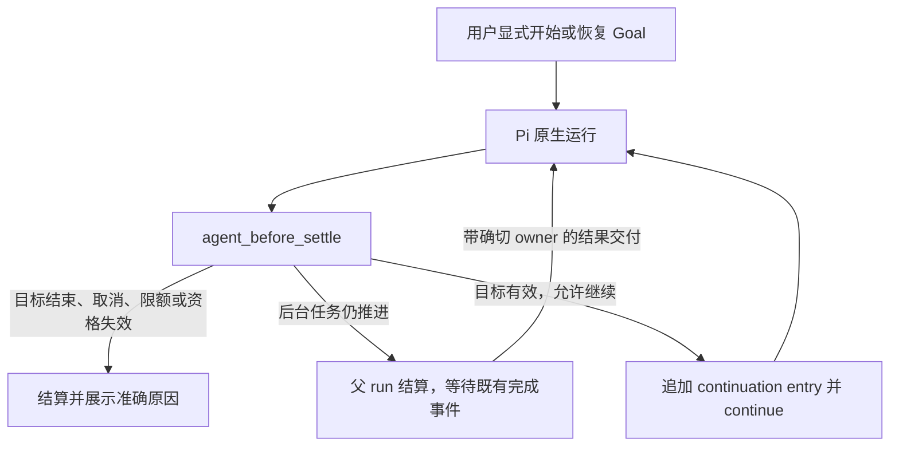

# Goal 模式：五家实现与 OpenPI 选型

- Status: draft。竞品事实已按下列源码／官方文档核对；OpenPI 方案、消融与实验协议仍是设计建议，不是已接受 Decision 或运行效果证明。
- Created / source-verified: 2026-10-23（Asia/Tokyo）。
- OpenPI baseline: `31b2d045ec7147ac5fc3b2e350bbd55b0a2aa7cd`，调研开始时 `openpi-dev/openpi/main`；单独工作区、分支 `codex/goal-mode-research`。
- Tracking: [#192](https://github.com/openpi-dev/openpi/issues/192)；关联 [#43](https://github.com/openpi-dev/openpi/issues/43)、[#879](https://github.com/openpi-dev/openpi/issues/879) / [PR #880](https://github.com/openpi-dev/openpi/pull/880)。
- Related PR: 尚未创建；本次只交付调研和选型建议。
- Supersedes: none。补充 #192 的 2026-08-26 历史审查，不改写当时结论。
- Evidence: 仓库外 `openpi-evidence/goal-mode-research-2026-10-23/`；各 `sources/<name>/identity.json`、`tree.json`、`receipts.json` 保存版本、原始 URL、字节数与 SHA-256。下列固定提交链接支持公开复核；本地归档不构成公共托管承诺。没有运行竞品、真实模型对照或新的 Benchmark。

## 建议先选什么

**推荐：Pi 原生生命周期上的单 Session Goal，主模型判断是否完成，运行时保证续跑资格、取消、持久化和资源边界。** 第一版用用户显式入口启动，仅增加一个模型侧结束／阻塞工具；独立评审模型留作后续有对照证据的可选能力。

理由是当前 Pi 已经提供收尾前的 continuation seam；OpenPI 可以补上持久目标，而不接管 Agent loop。Codex 的目标与执行分离、DeepSeek 的 durable state / live activation 分离最值得借鉴。Claude 的独立 evaluator 是另一种完成判定策略；它有额外费用且只看对话，不能直接当作外部验收器。

| 对象 | 核实到的机制 | 对 OpenPI 的意义 |
| --- | --- | --- |
| OpenCode 原生 | 普通工具循环、finish reason、step 上限和重复工具调用保护；在审查范围内未发现原生持久 `/goal` 子系统 | 工具循环和防重复不等于跨回合目标 |
| Kimi Code 当前版本 | 原生 Goal service；回合结束续跑；模型显式结束；token / turn / wall-clock 预算；恢复暂停、fork 清除 | 参考状态、预算、异常分类；区分当前实现与旧 Python Ralph |
| Claude Code | `/goal` 包装 session Stop hook；独立小模型返回未完成／达标／不可能 | 参考独立审查及后台等待；评审结论仍受对话证据限制 |
| Codex | 持久 Thread Goal、idle admission、模型 Goal 工具、累计记账、预算与错误终止 | 参考目标契约和执行边界；不复制它的存储或 provider 栈 |
| DeepSeek Harness | Goal 状态／工具／人类命令／round driver 分开；revision fence、durability checkpoint、armed/disarmed、后台后代等待 | 最贴近“正交机制组合”；只移植语义到 Pi seams |

## 核实边界与版本

| 来源 | 固定身份 | 边界 |
| --- | --- | --- |
| OpenPI main | `31b2d045ec7147ac5fc3b2e350bbd55b0a2aa7cd` | 当前源码；与原始 dirty checkout 分开 |
| Pi | `@earendil-works/pi-coding-agent@1.2.0` | OpenPI frozen lockfile 安装的发布包；检查扩展类型与 AgentSession 实现 |
| OpenCode 发布版 | `v1.19.4` / `148842ef7cb1bc34192b3fff57d0f9721ab9c801` | 普通 loop、processor、agent、todo |
| OpenCode dev | `2a3e7c0f349ba0e9454fa0529ec041cf57e53cb8` | 补查 V2 session/execution/runner；不把 dev 当发布版 |
| Kimi Code main | `087db850e02d3e487ac834c4867e90b3334a63d6` | 当前 TypeScript `MoonshotAI/kimi-code`；不冒充已安装版本 |
| Kimi CLI 历史 | `9ab1286b8fe4e6bcd116949a27ce5e0ac3389c82` | 已归档的 Python `MoonshotAI/kimi-cli`；只解释 Ralph 历史 |
| Codex main | `e6ebdfe00b520e21ed50ac0362656f32dd64d2fc` | 开源 Goal extension、state、app-server；不推断截图对应的桌面构建 |
| DeepSeek Harness master | `687f282e8625c6b8d11ff58211a90524be2e4317` | Goal 组源码与包文档；未执行 |
| oh-my-openagent dev | `dfbeeec9bcc06598d72fbe8b65eb44fb7d119a43` | 第三方 OpenCode 插件的 Ralph / ultrawork；与 OpenCode 原生分列 |
| Claude Code | 官方 `/goal`、hooks、scheduled-tasks 文档，访问日 2026-10-23 | 产品契约；闭源运行时未审计，文档快照已保存 |

原工作区 `work@dcebb07c788101f9e2eb634b1e6482602b634740` 有大量既存修改，包括旧 Goal。已保留，没有 stash、reset、清理或切换该工作区。`pi list` 报告唯一 OpenPI 来源为 `../../.codex/worktrees/openpi-pr561-safe/openpi`，并非本次新工作区；没有切换安装、reload 或进行实机 smoke。因此以下 OpenPI 判断只针对固定源码，不是对当前安装行为的诊断。

用户截图只提供“目标：设置要持续追求的目标”这一产品需求，不提供内部算法、存储、计费或后台运行的证据。

## 五家的具体实现

### OpenCode：普通循环与插件循环要分开

发布版 [`session/prompt.ts`][oc-prompt] 在一个 Session 中持续处理工具调用和待处理工作，按 finish reason 等条件退出；`agent.steps` 限制步数。[`processor.ts`][oc-processor] 对连续三次相同工具和输入触发 `doom_loop` 权限检查。它检测的是重复调用，不能判断业务目标是否完成。

发布版树中没有 Goal 命名的子系统，已检查的 session、agent、todo 源码也没有可与 Codex Goal 等同的持久目标控制面。这个否定结论限定于审查文件，不能外推成“所有 OpenCode 版本和插件都没有目标模式”。dev 的 V2 execution / runner 已重组，不能拿旧路径解释全部新代码。

生态中的 [oh-my-openagent Ralph hook][omo-loop] 才是另一层：在 idle 事件推进 iteration，读完成标记，检查迭代上限、后台任务和无进展；ultrawork 还存在 Oracle verification 路径。[完成标记检测器][omo-detector] 检查 assistant 输出中的 promise，特殊 verification 路径也读取工具结果。**标记被检测到只说明协议满足，不自动说明工作区通过了独立验收。** 本次没有执行 Oracle 路径或验证其有效性。

### Kimi：当前版本已有 Goal，不只是 Ralph

当前 [`GoalFeature`][kimi-feature] 注册 `CreateGoal`、`GetGoal`、`SetGoalBudget`、`UpdateGoal`。[`goalService.ts`][kimi-service] 维护当前主 Agent 的 Goal，在 turn 结束后提交带 `goal_continuation` origin 的后续输入，保留 pending handle 并可取消，防止旧 Goal 的工具写入新 Goal。

- 状态是 active / paused / blocked / complete。预算区分 token、turn 和 wall-clock；耗尽会由 runtime 停止推进，工具执行边界也检查预算。该源码将预算耗尽归为 blocked。
- 当前计量处理 `ctx.usage.output`；不能把这个 tokenBudget 当作跨产品统一的“全部输入输出 token”预算。
- replay 后 active Goal 被暂停；fork reducer 清除继承 Goal。模型 Goal 工具限制主 Agent 使用。`UpdateGoal` 可以 complete / blocked，也能请求 active，权限策略不能假定与 Codex 相同。
- “同一 blocker 连续三轮”写在模型提示与工具描述中；本次未见按语义条件维护三次 blocker 证明的 runtime ledger，不能称为确定性完成／阻塞验证。

已归档的 Python [`FlowRunner.ralph_loop`][kimi-ralph] 则循环输入任务，用 `<choice>CONTINUE</choice>` / `<choice>STOP</choice>` 和最大次数控制。它是历史上更轻的协议，不代表上述当前 Goal service。

### Claude：独立模型做回合后的条件判断

官方 [`/goal` 文档][claude-goal] 说明，一个 Session 一次一个条件；每次工作回合结束后，通过 session-scoped prompt Stop hook 调用配置的小模型，输出未达标、达标或不可能。后两者清除当前目标并留存结果。evaluator 不调用工具，只读取工作模型已经呈现的对话证据。

后台子代理／shell 尚运行时会延后评审；结果交付可启动下一回合。文档还规定无工具空转保护、后台 check-in 退避和错误处理。恢复会带回未结束条件，但重置部分运行计量基线。Goal 不改变工具权限。

[`/loop`][claude-loop] 是按时间调度提示，`/goal` 是按条件持续推进；auto permission mode 负责工具批准。这三个开关的职责独立。官方建议把时间／turn 条款写进条件由模型判断；不能据此声称它提供了与 runtime 硬预算等价的上限。以上是公开契约，本次没有验证闭源内部实现。

### Codex：目标属于 Thread，调度属于 runtime

当前公开源码已将 Goal 拆到 [`codex-rs/ext/goal`][codex-runtime]。状态持久化到 Thread Goal store，包含 goal_id、objective、status、token/time accounting；模型工具负责读取、显式创建和报告结束，app-server 提供用户控制。

[`continue_if_idle`][codex-runtime] 在状态锁内检查 continuation deferral 和最新 Goal，再调用原生 `start_turn_if_idle`；Goal active 只是必要条件，运行资格还由宿主 admission 决定。[生命周期 hooks][codex-extension] 处理 idle、turn stop、abort、provider error、usage 和工具结果。当前版本对连续空响应、执行失败有专门记账；不能仅根据较早的使用文档，把这些保护概括成一个永不变化的“没工具就停止”规则。

[`accounting.rs`][codex-accounting] 的 Goal token delta 是 `input - cached_input + output`，并有 descendant accounting。它既不是全部 wire token，也不是美元成本，不能直接与 Kimi output-only 数字比较。模型在 [`continuation.md`][codex-prompt] 中被要求按当前工作区／外部证据完成审计；“同一 blocker 三轮”仍包含模型判断，不是外部 verifier 的成功证明。[官方 Goal 说明][codex-doc]支持持久目标、用户控制与证据导向的产品语义。

### DeepSeek：把目标事实与自动执行资格分开

Goal 组由 `goal`、`tool-goal`、`command-goal`、`goal-round-driver` 组成。[Goal 类型][dsh-types] 区分持久的 active / paused / blocked / complete，以及仅当前进程有效的 armed / disarmed。恢复、fork 或重新挂载 driver 不会仅因磁盘里是 active 就自动获得运行授权。

[`goal-round-driver`][dsh-driver] 在 exact Agent idle、没有竞争输入且仍 armed 时预约一次 continuation；做 durability checkpoint，检查 goalId / revision，并在 pre-step 再次围栏检查。只有实际进入历史的 goal round 才消耗轮数。它等待仍在推进的后代，不靠空跑父回合等待；取消、卸载和写入错误关闭自动推进资格。轮数耗尽有独立 `round-limit` reason，轮数上限不等于 token / time / currency 预算。

[`authority.ts`][dsh-authority] 用根 Agent 的 host-attested human input 和 exact admitted goal round 区分修改权限。[`tool-goal`][dsh-tools] 的 blocked 阈值实际检查 round 数量；“同一语义 blocker”仍由模型判断。源码没有独立完成 evaluator。值得学的是这些所有权、revision 与恢复语义，而不是将 Cordis 容器和第二套 Session 系统搬进 OpenPI。

## OpenPI 当前基线与可复用位置

事实：`main` 已在 [PR #880][openpi-removal] 删除 `extensions/goal/` 和旧工具；旧工作区的代码不是待补一个菜单就能使用的现成功能。[Decision 0005 的 amendments][openpi-decision] 记载了删除及背景。重新引入属于新的功能取舍，需要在 #192 说明用途和常驻工具成本。

Pi 1.2.0 发布包的 `core/extensions/types.d.ts` 提供：

- `agent_before_settle`：收到 outcome、pendingMessages、上下文预览，可返回 `entries` 和 `continue`。
- `agent_settled`：自动 retry、compaction、queued continuation 都完成后的结算事件。
- `custom` entry 持久化扩展数据，`custom_message` 作为模型可见记录；两者本来就是不同投影。

`AgentSession._runBeforeSettleBoundary()` 先应用 boundary entries，再检查可执行上下文和 abort，决定是否继续。**应使用这一原生 seam，而不是把 `agent_end` 当作最终 idle。** Pi 的 turn 是一次 assistant／工具交互，run 可包含多次 turn；本建议的“Goal 自动轮次”是一次获准的收尾续跑，不是强行另建一个 Pi Session。

现有 OpenPI 还能复用：

| 位置 | 现有职责 | Goal 接入边界 |
| --- | --- | --- |
| `extensions/shared/child-execution-admission.ts` | 按 SessionManager 归属的 held / queued child 执行事实与订阅 | 作为后台工作事实之一；不能把释放 lease 单独当作结果已经交付 |
| `extensions/shared/completion-inbox.ts` | owner / epoch、消费竞争、重试与 dead-letter | 复用已存在的完成交付；不再给 Goal 做一套结果队列 |
| `extensions/plan-mode/index.ts` | Session branch 状态恢复和模式边界 | 参考持久化；计划态禁止 Goal 自动执行 |
| `web/runtime/pi-runtime.ts` | Pi 原生阶段、确切 controller origin、运行时保留与关闭 | 原生续跑保留来源；取消／换 Session 后不可拿“最近活跃 tab”授权 |
| `extensions/shared/child-session.ts` | 工具分类、已退役名称过滤 | 新 Goal 工具归 parent-only；处理旧名称退役记录，不让子代理递归自启动 Goal |

当前 package peer 范围仍允许 `>=0.99.1`，而本次核实的是锁定的 1.2.0。实现前需明确支持 boundary hook 的最低 Pi 版本；不支持时拒绝自动模式，或明确提高兼容下限。不能静默用 timer / `agent_end` fallback 冒充同一语义。

## 推荐方案的最小合同

以下均为待选择／实现的建议，不是现有功能承诺。

1. **一个 Session 当前 branch 一个 Goal。** Pi append-only custom entries 保存版本化快照：id、revision、objective、status、累计 usage 和停止 reason；clear 写 tombstone。错误／未知版本 fail closed。旧 `session-goal` 历史允许阅读，不因新扩展上线而复活。
2. **显式用户入口。** TUI `/goal` 和 Web composer 的“目标”入口操作同一状态；开始、编辑、替换、暂停、恢复、清除由用户控制。编辑保留 id / usage；替换新建 id。普通请求不会自动升级成长目标。
3. **第一版一个模型工具。** 候选 `update_goal({ goal_id, revision, status: complete | blocked, reason })`；最新目标随持久变更和 continuation 消息呈现，工具返回当前快照。用户入口已负责 create，状态已在上下文，因此先省掉 `create_goal`、`get_goal`。若普通自然语言创建后来确有需求，再独立评估它的授权入口和工具成本。
4. **工具表固定。** Session 开始注册简短定义；无 Goal 时执行返回缺少状态，不能在开始／结束 Goal 时增删工具或重写 system prompt。上下文按原生记录位置追加；压缩后从当前 branch 恢复目标，测试恢复提醒的位置与前缀稳定性。新工具的成本需按 Decision 0005 实测、论证，不能直接抬高测试上限。
5. **原生 boundary 续跑。** 只有用户已启动、当前进程仍 armed、当前 revision 有效、outcome 正常、没有待处理用户消息／计划／阻塞批准、资源允许时，收尾 hook 才追加一条带 Goal identity 的 continuation 并返回 `continue: true`。所有 await 后复查；原生 abort 必须压过 continuation。
6. **等待使用既有完成事件。** 模型结束本轮并留下当前 Goal 的推进中子任务时，让父 run 结算；由既有结果交付唤起下一次运行。模型仍可在本轮完成其他独立工作，不强制按子任务串行执行。held / queued / delivery 三者要一起审查，避免 lease 已释放但结果尚未交付时 Goal 抢跑；仅 Session 级 child 数量不足以判定与特定 Goal 的关联。普通 `nohup` 进程没有受管完成事件；不能凭锁文件假定仍活着，应让模型使用可核实的 handle / 状态或显式 `/cron`。
7. **取消与恢复分开。** Escape／Stop 撤销本次自动资格并保留 paused Goal；暂停 Goal 不冒充后台执行已经取消。停止子任务沿用各 owner 的 cancel，并保留真实 terminal evidence。属于已暂停／清除 Goal 的 late completion 可以记录和展示，但不能重新授予它自动执行资格；不能为此阻断无关用户输入。reload / restart / fork 不继承 armed；显式 resume 才继续。clear、替换、切 branch、shutdown 均使旧 callback / revision 失效。
8. **资源边界有准确含义。** 自动轮次按实际 admitted continuation 记账；资源上限和用户明确预算由 runtime 执行。token 上限在请求边界生效，已发请求可能超支，不能宣称逐 token 的硬保证；输入、缓存、输出、reasoning、子代理 usage 分列，未知计量不得伪造为零。耗尽记为限额停止，不能等同 complete。
9. **主模型作判断，runtime 保留来源。** 沿用 Pi 当前 provider / model / thinking、Trust 和工具权限；objective 作为任务数据，不提升权限或指令优先级。complete / blocked 都保存 reason 和 actor，但只是模型依据当前证据的结论，不标成“独立验收已通过”。工具成功、子代理 success、Workflow 成功也不能自动完成整个 Goal。prompt 要求按目标验收；测试／外部 verifier 的确切结果保留为另一层事实。
10. **空转关闭自动资格。** 可观察的无工具／无有效执行反复出现时停下并显示原因；该 circuit breaker 不推断业务已完成。模型可以基于真实阻塞直接报告 blocked；第一版不引入“重复三次同一句 blocker”或关键词完成识别。任何包级 limit／偏好都走现有 setup 合同，而非新增配置命令。

Web 第一版只需目标文本、状态、停止原因、累计使用和暂停／恢复／清除控件；TUI 显示同一事实。两者都不能以“已经显示最终回复”作为 run 终止依据。具体视觉设计和实现不在本次调研内。

## 方案取舍与设计消融

| 候选 | 收益 | 代价／缺口 | 建议 |
| --- | --- | --- | --- |
| 原提示反复重放 / Ralph | 实现短，快速增加坚持次数 | 标记不证明目标；状态、取消、恢复、预算仍需补齐 | 可作对照组 |
| Pi 原生持久 Goal + boundary continuation | 使用同一 Session 与模型；运行事实有明确 owner | 完成的语义判断仍依赖主模型；需验证全部边界 | 推荐第一版 |
| 上述机制 + 每轮独立 evaluator | 可减少工作模型自行宣告完成的偏差 | 每轮费用与延迟；只看对话的 evaluator 也可能漏判／误判 | 先测，作为显式可选能力 |
| 新建 supervisor / 外部 Agent runner | 可独立管理长任务 | 复制 Session、权限、恢复、provider 和清理所有权 | 当前目标不足以证明需要 |

按“去掉后是否仍满足持续推进、可停止、可恢复、证据可追溯”做了一轮**静态设计消融**：

| 尝试移除 | 推演结果 | 最小方案处理 |
| --- | --- | --- |
| 第二 Agent loop、外部 CLI runner、独立 DB | Pi 已拥有运行和 Session 生命周期 | 移除 |
| 常驻独立 evaluator | 主模型 + 原工具证据仍能完成基础目标契约；效果优劣未知 | 移出第一版默认方案 |
| `get_goal`、`create_goal` | 显式用户入口创建、上下文／返回值展示最新状态即可 | 第一版移除 |
| 强制 Todo、固定“计划→执行→验证”流程 | 不影响生命周期与可检查证据 | 移除 |
| blocker 字符串三次相等 | 去掉不会削弱取消、预算和 stale-write 保护 | 移除，保留模型判断和可观察空转保护 |
| 定时轮询和人工 sleep 等待子任务 | 受管任务已有交付事件 | 移除；非受管外部等待另用现有机制 |
| revision / owner、持久记录、取消资格、资源停止 | 会出现旧目标续跑、重启误跑或无法解释停因 | 保留 |

这轮消融是源代码支撑的设计推演，没有声称测得 token、成功率或墙钟收益。实现后还要实际移除候选部件并重跑验收，才能升级成运行验证结果。

## 实现前后的验收与实验协议

第一批应验证行为而不是 mock 某个内部方法的调用次数：

- 用户面：显式开始后持续推进；普通请求仍正常结束；Pause / Stop 可打断；resume 不换目标；clear 不显示成功；Web 和 TUI 状态一致。
- 模型面：完整 objective 在 compaction 后可见；ordinary / goal 请求的工具列表与 system prompt 保持固定；旧 revision 的完成调用失败；计划、子任务结果和 Goal 完成不混为一谈。
- runtime／持久层：用户输入与收尾续跑竞争、双 boundary、取消发生在 await 期间、子任务 lease 释放先于交付、暂停／clear 后晚到结果不得重新推进 Goal、provider retry / error / compaction、写盘失败、进程重启、fork／切 branch、旧格式／损坏 snapshot、预算耗尽、重复 usage 与子代理计量。
- headless：Goal 能跨原生 continuation 到终态再退出；blocked / 限额 / 取消不能报成功。后台任务的进程退出语义需单独覆盖。

效果实验建议冻结同一 OpenPI / Pi revision、模型 ID、thinking、provider、任务输入和独立 verifier，以 A「普通 Pi」、B「简短坚持提示」、C「最小 Goal」、D「Goal + 独立 evaluator」比较。D 的 evaluator 调用、延迟与费用必须计入，不能只统计工作模型。

任务至少覆盖：明确可完成的多步修复、验证失败须再迭代、上下文压缩恢复、真实不可推进、子任务等待、途中取消与恢复。记录 verifier success、误报完成、需要用户说“继续”的次数、无进展轮数、取消后新调用、恢复后重复副作用、全部 usage 和墙钟。candidate 不得修改 verifier 来降低标准；超时、provider／环境失败、模型失败分别分类。

这里只定义协议，**未执行**；没有样本量、提升百分比或跨产品优胜结论。增加常驻工具还需满足 Decision 0005 规定的 surface / output 对照与排除工具消融，不能用本次静态调研代替。

## 尚待选择与验证

- 维护者是否接受“显式入口 + 一个结束工具”的第一版范围，或需要一开始支持模型在普通自然语言请求中创建 Goal；后者要增加相应工具价值与授权设计。
- Pi 最低版本、默认资源 guard 的具体值，以及全 Goal 的 token 指标；本研究不替用户编造预算。
- 既有 Web origin 撤销和完成交付在新的 Goal boundary 下能否原样满足；须用真实 Pi deterministic provider fixture 验证，而非由相似代码推断。
- 独立 evaluator 对误完成、总费用和延迟的净收益；等待对照结果再决定，不预选第二模型。
- 真实 TUI / Web、远程 provider 和长时间运行的行为；本次均未做 smoke。

[oc-prompt]: https://github.com/anomalyco/opencode/blob/148842ef7cb1bc34192b3fff57d0f9721ab9c801/packages/opencode/src/session/prompt.ts
[oc-processor]: https://github.com/anomalyco/opencode/blob/148842ef7cb1bc34192b3fff57d0f9721ab9c801/packages/opencode/src/session/processor.ts
[omo-loop]: https://github.com/code-yeongyu/oh-my-openagent/tree/dfbeeec9bcc06598d72fbe8b65eb44fb7d119a43/packages/omo-opencode/src/hooks/ralph-loop
[omo-detector]: https://github.com/code-yeongyu/oh-my-openagent/blob/dfbeeec9bcc06598d72fbe8b65eb44fb7d119a43/packages/omo-opencode/src/hooks/ralph-loop/completion-promise-detector.ts
[kimi-feature]: https://github.com/MoonshotAI/kimi-code/blob/087db850e02d3e487ac834c4867e90b3334a63d6/packages/agent-core-v2/src/features/goal/goalFeature.ts
[kimi-service]: https://github.com/MoonshotAI/kimi-code/blob/087db850e02d3e487ac834c4867e90b3334a63d6/packages/agent-core-v2/src/features/goal/goalService.ts
[kimi-ralph]: https://github.com/MoonshotAI/kimi-cli/blob/9ab1286b8fe4e6bcd116949a27ce5e0ac3389c82/src/kimi_cli/soul/kimisoul.py
[claude-goal]: https://code.claude.com/docs/en/goal
[claude-loop]: https://code.claude.com/docs/en/scheduled-tasks
[codex-runtime]: https://github.com/openai/codex/blob/e6ebdfe00b520e21ed50ac0362656f32dd64d2fc/codex-rs/ext/goal/src/runtime.rs
[codex-extension]: https://github.com/openai/codex/blob/e6ebdfe00b520e21ed50ac0362656f32dd64d2fc/codex-rs/ext/goal/src/extension.rs
[codex-accounting]: https://github.com/openai/codex/blob/e6ebdfe00b520e21ed50ac0362656f32dd64d2fc/codex-rs/ext/goal/src/accounting.rs
[codex-prompt]: https://github.com/openai/codex/blob/e6ebdfe00b520e21ed50ac0362656f32dd64d2fc/codex-rs/ext/goal/templates/goals/continuation.md
[codex-doc]: https://developers.openai.com/cookbook/examples/codex/using_goals_in_codex
[dsh-types]: https://github.com/deepseek-ai/deepseek-harness/blob/687f282e8625c6b8d11ff58211a90524be2e4317/packages/goal/goal/src/types.ts
[dsh-driver]: https://github.com/deepseek-ai/deepseek-harness/blob/687f282e8625c6b8d11ff58211a90524be2e4317/packages/goal/goal-round-driver/src/index.ts
[dsh-authority]: https://github.com/deepseek-ai/deepseek-harness/blob/687f282e8625c6b8d11ff58211a90524be2e4317/packages/goal/tool-goal/src/authority.ts
[dsh-tools]: https://github.com/deepseek-ai/deepseek-harness/blob/687f282e8625c6b8d11ff58211a90524be2e4317/packages/goal/tool-goal/src/index.ts
[openpi-removal]: https://github.com/openpi-dev/openpi/commit/7dacac088d4da97fe7945198d6f6f6aa3cb5dc75
[openpi-decision]: ../decisions/0005-frozen-tool-surface.md
