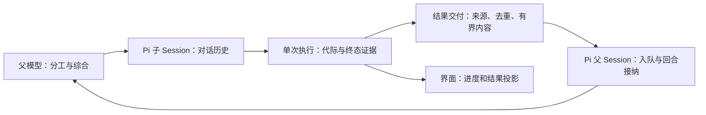

# 子代理设计比较：OpenCode、Kimi、Claude Code、Codex 与 DeepSeek Harness

- Status: `draft`。固定源码调查与设计建议，尚未形成 accepted Decision。
- Created: 2026-10-23。
- Verified: 2026-10-23；验证范围是选定源码、官方文档与下述静态消融。
- Source boundary: OpenPI `31b2d045ec7147ac5fc3b2e350bbd55b0a2aa7cd`；同行版本见下表。没有运行同行 harness、模型 Benchmark 或用户现场复现。
- Related Issues: [#196][issue-lifecycle]、[#512][issue-print]、[#652][issue-receipt]、[#891][issue-history]。
- Related PRs: [draft 文档 PR #898](https://github.com/openpi-dev/openpi/pull/898)；无本次实现 PR。[#515][pr-print] 是 #512 的历史候选，不能当作当前实现。
- Related records: [Completion Inbox](../design/COMPLETION_INBOX.md)、[Session child-execution admission](../design/SESSION_CHILD_EXECUTION_ADMISSION.md)；本文沿用其所有权边界。
- Supersedes: 无。不改写既有研究，也不把旧 Issue 的源码结论自动升级到当前 main。

## 结论与建议边界

**建议保留 OpenPI 的进程内 Pi 子 Session，在现有实现上明确会话、单次执行、结果交付和宿主生命周期的边界。** 优先比较这些边界的语义，再决定是否补齐能力。现有主干已经有共享准入、结果 inbox 算法、Session epoch、单次执行代际、完成收据和保存的子会话历史，不能把它描述成一张白纸。

值得借鉴的分别是 Kimi 的 Agent/Task 身份区分、Codex 的消息入队与唤醒区分、DeepSeek 的 Session/activation 区分，以及 OpenCode 的前台转后台交接。这些机制能够分别采用，不要求复制其中任何一家的完整框架。

以上是建议。本文没有证明某个同行设计更快、更省 token，或已经定位用户看到的时机问题。

## 来源身份

| 系统 | 读取的源码或文档 | 证据边界 |
| --- | --- | --- |
| OpenPI | `main` / `31b2d045ec7147ac5fc3b2e350bbd55b0a2aa7cd` | 本次 fetch 后的 upstream/main；独立工作区，保留原目录未提交改动 |
| OpenCode | `anomalyco/opencode` / `dev` / `2a3e7c0f349ba0e9454fa0529ec041cf57e53cb8` | 当前开发分支的 V2 `packages/core`；不与旧 V1 Task 实现混用，也不代表某个已安装发行版 |
| Kimi Code | `MoonshotAI/kimi-code` / `main` / `087db850e02d3e487ac834c4867e90b3334a63d6` | TypeScript agent-core-v2；不混用旧 Python kimi-cli 的实现 |
| Codex | `openai/codex` / `main` / `e6ebdfe00b520e21ed50ac0362656f32dd64d2fc` | 检查当前 completion/control 及 multi_agents_v2；旧 V1 wait 另有实现，不推断所有客户端采用相同协议 |
| DeepSeek Harness | `deepseek-ai/deepseek-harness` / `master` / `687f282e8625c6b8d11ff58211a90524be2e4317` | activation manager、catalog、工具及 base composition；可选 provider 不等于默认装配 |
| Claude Code | [Anthropic 官方子代理文档][claude-doc]，2026-10-23 读取 | 滚动产品文档；没有官方完整运行时源码，交付原子性和崩溃恢复内部机制未知 |

公共选定源码的本地证据保存在仓库外：`/Users/admin/Documents/ChatGPT/openpi-evidence/subagent-design-2026-10-23-31b2d045/`。四个系统分别保留 `identity.json`、`tree.json`，根目录的 `receipts.json` 和 `supplemental-receipts.json` 记录下载 URL、字节数与 SHA-256。固定提交链接支持独立复核，本机路径不是公共托管承诺。没有下载或发布私有 Session。

运行时来源另行核对：原工作区 HEAD 为 `dcebb07c788101f9e2eb634b1e6482602b634740`；`pi list` 仅列出一个 OpenPI spec：`../../.codex/worktrees/openpi-pr561-safe/openpi`，并非本次新工作区。尝试读取 `/Users/admin/.codex/worktrees/openpi-pr561-safe/openpi` 时该目录不存在，因此没有证明已安装运行时的实际 checkout 或内存版本。本文只讨论固定源码，未更改安装来源，也不据此诊断正在运行的 Pi。

## 一、先把选型拆成独立维度

“用哪家的子代理方案”容易把互不相关的选择捆绑起来。更有用的比较是：

| 维度 | 可选语义 | 实际取舍 |
| --- | --- | --- |
| 执行载体 | 当前进程的原生子 Session / 外部进程或远程 provider | 原生复用模型、工具与 Trust；外部载体增加协议、权限与清理成本 |
| 初始上下文 | 独立任务提示 / 父历史快照 fork | 前者隔离噪声但需要交接；后者保留背景，也复制体积和隐含假设 |
| 调用方式 | 等结果返回 / 立即返回身份 | 同步组合直观；后台允许继续工作，必须有明确的结果交付与退出语义 |
| 会话复用 | 一次性 / 保留历史并显式继续 | 继续会话减少重复交接，但需要区分会话身份和执行身份 |
| 结果进入父上下文 | 工具返回 / 自动消息 / 可读取的保存结果 | 结果抵达与模型实际读取是两件事；大结果还需要有界投影和可恢复引用 |
| 唤醒父代理 | 只入队 / 安全边界继续 / 空闲时启动新回合 | 影响交互连续性、用户取消，以及会话退出后的行为 |
| 恢复 | 只恢复记录 / 可冷启动继续对话 / 恢复原执行 | 历史可读不证明原进程、工具调用或外部副作用可恢复 |
| 权限与资源 | 父权限交集、准入、工作树、终止证据 | 上下文隔离和 worktree 都不能替代执行权限或操作系统隔离 |

这里的同步任务、可继续会话和持久任务是几种组合方式，并非互斥的产品类别。

## 二、五家的实现与取舍

| 系统 | 已核对的机制 | 优点（设计判断） | 代价与边界（设计判断或未知） |
| --- | --- | --- | --- |
| OpenCode V2 | 原生 child Session；默认等待、可选 background；用 sessionID 继续；Job 跟踪执行；synthetic 消息回父 Session | 普通调用易组合，同一任务可从阻塞转后台，子对话可继续 | Session、Job、通知和恢复记录需要协调；开发分支行为不能代替 V1 或已发布版本 |
| Kimi Code | Agent 保存子会话；每次调用注册独立 Task；前台与后台共用任务管理；WaitFor 返回结果后抑制自动重复通知 | 会话与执行身份清楚；任务状态、输出、通知与 lost 恢复形成完整闭环 | 任务服务覆盖 Agent、Bash、问答等，状态与持久化机制较多；不宜直接搬成第二个 Pi 控制面 |
| Claude Code | 官方文档区分 fresh subagent 与 conversation fork，支持后台通知、前台等待和 resume；当前 fork mode 会影响前后台默认行为 | 用户侧交接与控制清晰；可按任务选择隔离上下文或保留完整背景 | 默认行为随版本和模式变化；私有实现的队列、回执与崩溃窗口无法由文档证明 |
| Codex | 原生 agent thread；spawn/follow-up/message/interrupt；completion 独立路由；V2 wait 等消息活动、用户输入或超时 | 协作由小原语组合；等待与消息交付分离；父模型决定如何推进和综合 | 协作与线程生命周期更复杂；通知路由明确是 best effort，不能许诺 exactly-once |
| DeepSeek Harness | durable local Session + 最多一个 live activation；manager 管准入、交付、冷继续和清理；provider seam 扩展执行载体 | 生命周期责任明确；同一子会话可继续，单次 activation 的取消不会误操作后续执行 | 多 provider、递归关系、冷恢复与清理使管理器较重；OpenPI 当前只有 Pi 后端，收益不足以抵消照搬成本 |

### OpenCode：一次调用可以等待，也可以交给后台

[Subagent 工具][oc-tool]创建带 `parentID` 的子 Session，新建时使用独立上下文；传入 `sessionID` 必须属于当前父 Session。模型选择依次考虑调用覆盖、角色配置与父模型。递归深度由运行时检查。

[SubagentJob][oc-job]通过 Job 启动或加入执行，通知观察器按 `childSessionID:startedAt` 区分代际。[completion][oc-completion]把结果或失败封装成 synthetic 输入，成功后确认对应后台记录。[Job][oc-jobs]的运行注册表属于进程内；显式可恢复的后台元数据另存 KV。它不是“所有执行都自动持久化”的证据。

可借鉴的是前台/后台共享同一执行事实及交接点。是否需要该体验，与是否新增独立调度框架无关。

### Kimi：会话身份与调用身份分开

[Agent 工具][kimi-agent]区分继续已有 `agent_id` 与创建新 Agent，并为调用注册单独的 `task_id`。后台立即返回；前台等待 foreground release，同一次调用也可以被用户转后台。

[TaskService][kimi-tasks]区分终态、排队通知与交付标记。显式等待交付会撤回待发送通知并记录相应身份；恢复时仍非终态的旧任务标为 `lost`，不是假装原执行仍在运行。通知使用来源元数据和保存输出，不只依赖一句“Agent 已完成”。[持久化层][kimi-persist]保存任务元数据与输出；恢复对话历史不保证重放丢失的工具结果是安全的。

可借鉴的是这组语义。Pi 已有 Session 日志、生命周期和消息注入，OpenPI 无须再复制 Kimi 的整套任务服务。

### Claude Code：以官方产品合同为边界

[官方文档][claude-doc]支持独立任务上下文、conversation fork、恢复子代理和后台结果通知。当前 fork mode 会改变默认启动行为，不能沿用旧资料把“默认同步”视为永久事实。文档还区分自动完成事件与用户消息，结果中的权限声称不会成为用户授权。

可以借鉴其上下文选择、来源标注与用户控制。文档没有证明内部 exactly-once、跨进程通知原子性或某个收件箱实现；本次也不使用第三方复原版充当 Anthropic 源码。

### Codex：消息抵达与启动下一回合分别决定

[官方文档][codex-doc]把委派、线程检查、等待和综合交给父代理；权限与模型配置仍有父级来源。[child config][codex-config]从调用时的有效 step/turn 配置构造子配置，避免复制过时的模型或权限快照。

[completion][codex-completion]让 Session 捕获终态、controller 路由结果。当前这条完成消息明确设置 `trigger_turn=false`，并单独记录 queued/failed 指标。[delivery][codex-delivery]也显式区分 QueueOnly 与 TriggerTurn。**这只证明该运输路径请求只入队，不证明所有宿主、所有版本或其他控制路径永远不会唤醒父代理。**

[V2 wait][codex-wait]等待父输入队列的 mailbox 活动、用户 steering 或超时；它不等价于“所有给定 child ID 都进入终态”。因此不能仅凭工具名称比较两家的同步语义。

### DeepSeek Harness：持久会话与活跃执行分开

[子代理合同][dsh-doc]把 local child Session 与 activation 分开；`delivery: parent` 负责父通知，`delivery: caller` 只由调用者收结果。模型工具在当前版本启动 activation 后返回 child ID，不应把早期资料的前台选项直接套到它身上。

[manager][dsh-manager]串行化输入接纳与关闭；自然结束前检查待处理输入和拥有的子执行，清理后向精确的直接父 Agent 发终态 notice。[catalog][dsh-catalog]保存发现和归属信息。对外部执行，能列出历史记录不意味着能接受后续输入。

[base composition][dsh-base]实际装配原生 spawn/fork；存在 Codex、Claude Code、ACP 等 provider 包不代表默认启用。[fork provider][dsh-fork]只复制到最后一个完整 turn 的历史前缀，避免继承尚未闭合的工具调用。其多后端框架适合该项目的需求，OpenPI 可以只采纳身份和所有权原则。

## 三、建议给 OpenPI 的上层抽象

子代理可理解为：**有权限边界的 Pi 子 Session，由父模型发起一次或多次执行，通过有归属的结果消息协作。** 子代理不必常驻执行，也不自动成为独立项目、团队成员或持久工作流。

图中的概念对应现有 Session、manager、runGeneration、completion inbox 与 Pi 消息接口，不要求为每个框再写一个新类或存储。

| 概念 | 要回答的问题 | OpenPI 已有事实 | 建议明确的合同 |
| --- | --- | --- | --- |
| 子 Session | 这段历史属于谁，能否继续？ | `meta.sessionId`、sessionFilePath、send/restart、保存的子历史 | 对话历史恢复与原执行恢复分别声明 |
| 单次执行 | 这是这个子会话的第几次工作？ | `runGeneration`、`completionGeneration`、`executionId` 和终态来源 | 等待、取消、完成收据明确指向哪一代；继续新工作是否有意取代旧结果 |
| 结果交付 | 哪个父会话有权接收，是否已经送出？ | owner Session+epoch、claim/consume/retry；有界结果和证据引用 | 排队、运输接受、模型读取分别可解释；不把进程内去重描述成跨重启 exactly-once |
| 宿主接纳 | 此刻是否可以继续父回合？ | Pi `isIdle`、`agent_settled`、`followUp` + `triggerTurn` | 结果入队、唤醒父回合及进程退出作为不同问题处理 |

模型负责选择分工、角色、交接内容、是否同步以及综合结论。运行时负责权限交集、准入、代际、取消、终态和消息归属。角色 preset 是 prompt 与工具约束，不能代替另一套执行生命周期。

## 四、OpenPI 当前设计的优点与待决问题

### 已有优点

- [Pi backend][op-pi]使用原生 `createAgentSession`、SessionManager、模型/思考继承和子工具策略，保持 Pi 原生组合；没有另建 provider stack。
- [manager][op-manager]负责容量、事件归并、重启窗口与有界停止；停止超时保留不确定性及准入占用，不把“发出 abort”当成可靠终止。
- [result delivery][op-delivery]同时处理“child 先结束”和“parent 先空闲”两个边缘；显式 wait 与自动交付协调，忙碌期间能合批。
- [completion inbox][op-inbox]已有 owner/epoch fencing、认领、重试与有界 dead letters。各生产者复用算法并创建自己的实例，并非一个全局调度器。
- [完成投影][op-completion]已经区分执行事实、模型报告和未知验证；[#891 的研究][op-history]记录了子会话历史发现与显式继续的进展。

### 待决问题，而非本次已复现 bug

1. **一次宿主运行何时算结束。** [spawn 指引][op-prompt]让模型继续其他工作或结束回合并等待自动结果；[交付器][op-delivery]承诺父回合被唤醒。[#512][issue-print]记录过 print/json 宿主提前退出问题，但旧实验不能证明当前主干仍复现。应先建立 TUI、常驻 RPC/Web、一次性 print/json 的能力表，不能把 `hasUI` 当作能否以后继续回合的判据，也不能只靠“必须 wait”提示词补运行时边界。
2. **继续对话如何处理上一代结果。** 当前完成投影用 `sa-id:run:generation`，自动交付 ID 仍是 `subagent:sa-id`；[send 工具][op-index]明确把尚未交付的旧结果视为被新工作取代。先确认这是期望的产品语义，再判断是否需要按执行代际交付；不能看到 ID 不同就直接认定丢结果。
3. **等待究竟等待什么。** 当前 `subagent_wait(ids)` 等全部指定子代理结束，打断等待保留子执行。Codex V2 的活动等待、Kimi 的任意完成/超时等待是另外两种原语。只有实际协作场景需要时才补充；不为表面功能对齐增加工具。
4. **运输成功是否足够。** 当前交付把同步 `sendMessage` 返回作为运输成功；这不能证明随后模型读到结果。Session shutdown 清空进程内交付状态，保存历史也不等于有持久交付回执。是否需要恢复未读取结果，应以用户场景决定，而非直接引入全局 job DB。
5. **fresh 与 fork 的成本边界。** 当前 fresh 子上下文干净，但父模型必须交接足够背景。fork 能减少重复解释，也继承噪声与更大的上下文。先保留 fresh 默认；若后续要加入 fork，应复用 Pi 分支/完整消息边界，单独测量成功率、总 token 与延迟，不能许诺缓存收益。
6. **取消与清理分别证明。** 打断 wait、停止 child、清除未来自动唤醒和释放资源是不同操作。保留现有不确定性表达，明确父用户取消或 Session 替换后旧完成消息的归属，不用 UI 的 done 状态推断资源已终止。

## 五、候选方向与推荐

| 方向 | 获益 | 代价 | 建议 |
| --- | --- | --- | --- |
| A：以同步任务调用为主 | 因果关系直观，适合一次性调用和结果依赖 | 交互父回合可能长时间占用；后台交接仍要单独解决 | 作为组合能力或宿主适配，不改成所有交互场景的默认 |
| B：Pi 子 Session + 独立执行身份 + 结果事件 | 复用现有机制；父模型灵活安排并行与综合；可逐项澄清时机 | 必须把宿主退出、消息消费与取消边界说清楚 | **优先方向**；先确定合同和验收，再做最小修补 |
| C：持久团队与多 provider 调度层 | 服务长期团队、异构后端与跨进程恢复 | 身份、授权、存储、递归和清理成本大，容易与 Pi 重叠 | 当前没有足够需求支撑；不纳入本轮 |

选择 B 不要求同时做 fork、持久 outbox、任意完成等待或新工具。第一步应是宿主能力与结束条件矩阵、既有身份的含义、结果/取消的时序合同；后续实现按复现证据拆分。

对项目 feature decision test 的回答：

| 问题 | 本建议的答案 |
| --- | --- |
| Pi 哪个原语拥有生命周期？ | AgentSession / SessionManager、extension 生命周期、输入队列和消息回合接纳 |
| 判断还是不变量？ | 分工、上下文选择与综合属于模型；归属、权限、容量、终态、取消属于运行时 |
| 能否用正交机制？ | 继续组合 spawn/send/wait/cancel/check 与现有交付；没有固定 plan→worker→reviewer 流程 |
| 更强模型能否直接受益？ | 更好地选择任务、交接与同步策略，无须改写运行时流程 |
| 如何区分成功、失败、取消和未知？ | 单次执行的 owner 终态和完成收据；外部任务验收仍独立，不从模型 final 文本推断 |
| 谁能停止与清理？ | 父 Session/manager 的精确归属与子工具边界；有界停止、清理来源和不确定性分别表达 |

## 六、设计消融与后续验证

这是静态设计消融，不是模型 A/B 或运行时性能实验。验收目标是：保留现有交互后台行为、清楚的执行身份、受限权限、确定的结果归属，以及可停止和可解释的退出。

| 尝试移除的设计 | 是否仍满足目标 | 处理 |
| --- | --- | --- |
| 统一多 provider 抽象及全局任务数据库 | 是，当前只需要 Pi 后端；已有 Session 日志与生产者状态足够表达本轮方案 | 从推荐范围移除 |
| 固定角色流水线和自动递归团队 | 是，父模型可组合现有委派机制 | 从推荐范围移除 |
| 新增独立 Session/Run/Delivery 类层级 | 是，现有字段与模块已经承载这些概念 | 只澄清语义，不推荐按图造类 |
| fork、持久 outbox、wait-any 同时落地 | 是，本轮上层选型并不依赖它们 | 留作有证据需求时的独立选择 |
| Session/执行身份的区分 | 否，继续同一 child 会使等待、取消和完成归属含混 | 保留概念区分，复用现有 generation |
| 交付与唤醒的区分 | 否，无法解释忙碌父回合、用户取消和一次性宿主退出 | 保留合同区分；Pi 仍拥有回合接纳 |
| 权限交集、owner fencing 和不确定终态 | 否，会失去可执行的权限、归属或停止事实 | 保留现有运行时保护 |

选型后需要分别验证以下场景：child 在 parent 忙/闲边缘完成；wait 与自动结果竞争；用户输入打断等待；同一 child 多次继续；取消与完成竞争；Session 切换/重载；宿主退出；记录可恢复但原执行不可恢复。每个场景分别观察执行终态、消息接纳、模型实际上下文和 UI；不把其中一层的通过当成其他层的证明。

本次 `bun run check` 通过；Node 24.22.1 / Bun 1.3.14、隔离 `PI_CODING_AGENT_DIR` 下的完整 `bun run test` 通过：Node 2,421 项通过、8 项跳过，UI 107 个文件 / 1,640 项通过。最初继承个人非默认 UI 配置时有 6 个渲染/页脚断言失败；相同的 3 个文件在隔离配置下 11 项全部通过，随后完整重跑通过。没有修改实现、测试断言或个人配置。40 个同行文件的字节数和 SHA-256、16 个同行固定源码引用、文档引用定义与仓库文档合同检查通过。日志在上述证据目录中保存。

这些检查只能验证文档、仓库合同和测试环境下的行为，不能验证同行运行结果、当前安装、现场时机问题或采纳后的性能改善。

[issue-lifecycle]: https://github.com/openpi-dev/openpi/issues/196
[issue-print]: https://github.com/openpi-dev/openpi/issues/512
[issue-receipt]: https://github.com/openpi-dev/openpi/issues/652
[issue-history]: https://github.com/openpi-dev/openpi/issues/891
[pr-print]: https://github.com/openpi-dev/openpi/pull/515
[claude-doc]: https://code.claude.com/docs/en/sub-agents
[codex-doc]: https://learn.chatgpt.com/docs/agent-configuration/subagents
[oc-tool]: https://github.com/anomalyco/opencode/blob/2a3e7c0f349ba0e9454fa0529ec041cf57e53cb8/packages/core/src/tool/plugin/subagent.ts
[oc-job]: https://github.com/anomalyco/opencode/blob/2a3e7c0f349ba0e9454fa0529ec041cf57e53cb8/packages/core/src/session/subagent-job.ts
[oc-completion]: https://github.com/anomalyco/opencode/blob/2a3e7c0f349ba0e9454fa0529ec041cf57e53cb8/packages/core/src/session/subagent-completion.ts
[oc-jobs]: https://github.com/anomalyco/opencode/blob/2a3e7c0f349ba0e9454fa0529ec041cf57e53cb8/packages/core/src/job.ts
[kimi-agent]: https://github.com/MoonshotAI/kimi-code/blob/087db850e02d3e487ac834c4867e90b3334a63d6/packages/agent-core-v2/src/agent/tools/agent/agentTool.ts
[kimi-tasks]: https://github.com/MoonshotAI/kimi-code/blob/087db850e02d3e487ac834c4867e90b3334a63d6/packages/agent-core-v2/src/agent/task/taskService.ts
[kimi-persist]: https://github.com/MoonshotAI/kimi-code/blob/087db850e02d3e487ac834c4867e90b3334a63d6/packages/agent-core-v2/src/agent/task/persist.ts
[codex-config]: https://github.com/openai/codex/blob/e6ebdfe00b520e21ed50ac0362656f32dd64d2fc/codex-rs/core/src/agent/child_config.rs
[codex-completion]: https://github.com/openai/codex/blob/e6ebdfe00b520e21ed50ac0362656f32dd64d2fc/codex-rs/core/src/agent/control/completion.rs
[codex-delivery]: https://github.com/openai/codex/blob/e6ebdfe00b520e21ed50ac0362656f32dd64d2fc/codex-rs/core/src/agent/control/delivery.rs
[codex-wait]: https://github.com/openai/codex/blob/e6ebdfe00b520e21ed50ac0362656f32dd64d2fc/codex-rs/core/src/tools/handlers/multi_agents_v2/wait.rs
[dsh-doc]: https://github.com/deepseek-ai/deepseek-harness/blob/687f282e8625c6b8d11ff58211a90524be2e4317/docs/subsystems/subagent.md
[dsh-manager]: https://github.com/deepseek-ai/deepseek-harness/blob/687f282e8625c6b8d11ff58211a90524be2e4317/packages/subagent/subagent/src/manager.ts
[dsh-catalog]: https://github.com/deepseek-ai/deepseek-harness/blob/687f282e8625c6b8d11ff58211a90524be2e4317/packages/subagent/subagent/src/catalog.ts
[dsh-base]: https://github.com/deepseek-ai/deepseek-harness/blob/687f282e8625c6b8d11ff58211a90524be2e4317/packages/bundle/base/cordis.patch.yml
[dsh-fork]: https://github.com/deepseek-ai/deepseek-harness/blob/687f282e8625c6b8d11ff58211a90524be2e4317/packages/subagent/subagent-fork-in-process/src/index.ts
[op-pi]: https://github.com/openpi-dev/openpi/blob/31b2d045ec7147ac5fc3b2e350bbd55b0a2aa7cd/extensions/subagents/src/backends/pi.ts
[op-manager]: https://github.com/openpi-dev/openpi/blob/31b2d045ec7147ac5fc3b2e350bbd55b0a2aa7cd/extensions/subagents/src/manager.ts
[op-delivery]: https://github.com/openpi-dev/openpi/blob/31b2d045ec7147ac5fc3b2e350bbd55b0a2aa7cd/extensions/subagents/src/result-delivery.ts
[op-inbox]: https://github.com/openpi-dev/openpi/blob/31b2d045ec7147ac5fc3b2e350bbd55b0a2aa7cd/extensions/shared/completion-inbox.ts
[op-completion]: https://github.com/openpi-dev/openpi/blob/31b2d045ec7147ac5fc3b2e350bbd55b0a2aa7cd/extensions/subagents/src/completion.ts
[op-prompt]: https://github.com/openpi-dev/openpi/blob/31b2d045ec7147ac5fc3b2e350bbd55b0a2aa7cd/extensions/subagents/src/prompt.ts
[op-index]: https://github.com/openpi-dev/openpi/blob/31b2d045ec7147ac5fc3b2e350bbd55b0a2aa7cd/extensions/subagents/index.ts
[op-history]: WEB_LIFECYCLE_AND_CHILD_HISTORY_2026-10-22.md
